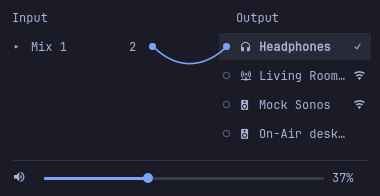

# on-air for Omarchy Quickshell

A native QML bar widget with a compact two-column popup. The content is
380 logical pixels wide, scaled by Omarchy's font and spacing settings.
The panel uses Omarchy's own popup host, typography, colors, border and
animation preference. It adds no webview and owns no audio resources.



## Install from this checkout

Build and install the updated core first, then install the widget:

```sh
packaging/omarchy/install.sh
sh packaging/omarchy/install-plugin.sh --enable
```

The second command copies the frontend into
`~/.config/omarchy/plugins/on-air.patchbay/`, validates it when Omarchy is
available, and enables it beside the centered clock. It requires Omarchy
4's native shell plugin API. It can also be enabled later:

```sh
omarchy plugin enable on-air.patchbay
```

Updates use `--replace`, which backs up the previous directory outside the
plugin search path. The installer never overwrites an existing copy unless
that flag was supplied. The existing TUI remains available.

## Use

- Click a device row to select it as the system default. Its checkmark is
  separate from its routing socket. The single footer slider controls the
  selected device, or the default output when there is no selection.
- Drag a socket to a row on the opposite side to connect audio. Dragging
  works in either direction. The cable becomes solid after the core
  confirms the local route; unavailable routes are dashed and show an error.
- Drag one row body onto another on the same side to create an input mix
  or an output group. Drop onto an existing group to add members. Groups
  start collapsed; the disclosure arrow reveals their members.
- Right-click a row for keyboard-accessible connection targets, default,
  mute, disconnect and group removal. Right-click a cable to disconnect it.
- Arrow keys move the selection, Enter selects a default, Space or M mutes,
  Delete disconnects, and Menu or Shift+F10 opens the selected row's menu.
  Escape cancels a drag or closes the panel.

To route application audio through the **Desktop** source, select
**On-Air desktop** as the system output. Applications already pinned to a
different output keep their existing assignment. Hardware monitor sources
are also available when a specific physical output should be captured.

AirPlay and Sonos devices become individually named virtual system outputs.
Applications can select these directly, without an explicit patch cable.
The core starts a sender when an application or route feeds that sink.
Independent AirPlay streams use direct **pyatv** sessions: install
`python-pyatv` and allow LAN discovery to find the receiver's address.
OwnTone's shared player remains supported by the original exclusive API.
Pairing and receiver-model limitations of the existing transports still apply.

Output groups use **independent timing**. Network buffering and different
device clocks can produce delay or audible differences between rooms.
Input mixes attenuate each member by `1 / member_count` to provide headroom.
The existing network pipeline's mono format is retained. This frontend
does not claim synchronized playback across transports.

Routes and groups belong to the core, are saved in `patchbay.json` beside
its settings, and reconnect when devices return. Closing or reloading the
shell leaves playback running. Pausing the core stops links and senders;
resuming restores the saved graph. Feedback through monitors is rejected.

## Motion and theme

The cable is a small Verlet rope with fixed endpoints, gravity, damping
and distance constraints. It trails the pointer, swings and settles into
a hanging curve. Its timer sleeps once settled and while the panel is
hidden. Omarchy's `Style.reduceMotion` disables animation while preserving
the static hanging shape. A per-widget `reducedMotion` setting can also
force this. A `port` setting overrides the default loopback port 47990.

## Verify without Omarchy or audio hardware

```sh
cargo build --locked -p on-air-core
node --test apps/quickshell/tests/rope.test.mjs
python3 -m pip install PySide6
QT_QPA_PLATFORM=offscreen QT_QUICK_BACKEND=software \
  python3 apps/quickshell/tests/render.py \
  --core target/debug/on-air-core --output /tmp/on-air-panel.png
```

The Qt test starts the real mock core, loads the actual panel, exercises
body dragging, cable dragging, volume and keyboard mute, saves a screenshot,
and checks that closing the UI leaves the route alive. Pass `--font` with a
local Nerd Font to render icons exactly as Omarchy does. For an interactive
Qt preview, start a core and open `Preview.qml` with Qt's `qml` tool.
