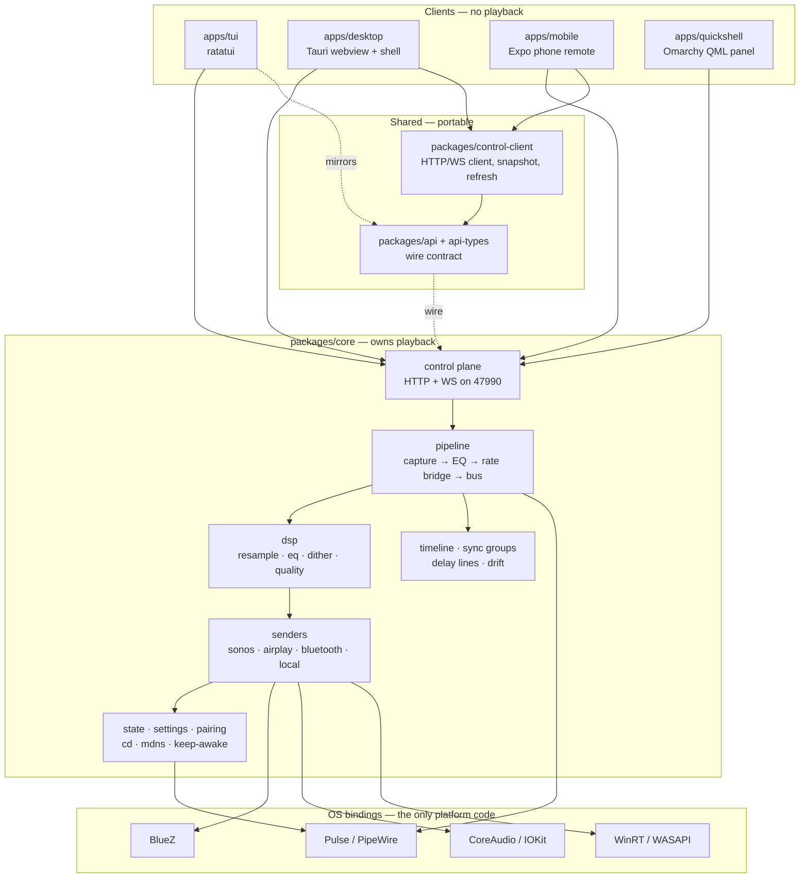

# Cross-platform TUI / GUI architecture

Architecture note, 2026-10-19 · `omp/improve-2026-10-19`

This describes how on-air is shaped across Linux, macOS and Windows today and
records the boundaries already enforced in code. Unchecked checklist items
remain future work.

## The one rule everything else follows

**Playback is owned by one Rust process; every UI is a client of it.**

`packages/core` is `on-air-core`. It captures audio, runs the DSP, owns the
sender, and exposes an HTTP + WebSocket control plane on port **47990**. The
terminal UI, the tray app, the phone remote and the Omarchy panel all talk to
that plane and none of them own playback. Closing any of them changes nothing
about what is playing.

That is what makes the platform question small. The hard parts — device
enumeration, DSP, protocol timing — live in one crate that is portable. What
varies per platform is the shell around it and a handful of OS bindings.

## Modules

```
packages/core          the core: capture, DSP, senders, control plane (on-air-core)
packages/api           Rust wire types
packages/api-types     the same types in TypeScript
packages/control-client  shared HTTP/WS client for desktop and phone
apps/tui               ratatui terminal UI and CLI (Linux primary, portable)
apps/desktop           Tauri tray app: React webview + a Rust shell embedding the core
apps/mobile            Expo phone remote
apps/quickshell        Omarchy 4 QML panel (Linux, Omarchy only)
```

## IPC to the core

Everything uses the same two channels. There is no platform-specific IPC.

| Channel | Shape | Used for |
| --- | --- | --- |
| HTTP | `GET`/`PUT`/`POST` on `/api/...` | state, commands, the audio check, sync and channel settings |
| WebSocket | `/api/ws` | level meter, device join/leave, input/output and CD state |

**Auth.** A local desktop is trusted by origin. Remote clients pair with a PIN
and get a bearer token. The radio stream under `/stream/{nonce}/audio.wav` is
unauthenticated by design — a speaker pulls it and has no way to present a
token.

**The core is in-process on desktop and out-of-process on Linux.** The Tauri
shell spawns `on_air_core::serve` on loopback and the webview talks to it over
the same HTTP/WS the phone uses. On Linux, `on-air-core` is a systemd user
service and the TUI is a separate process. Either way the client code is
identical — which is the point.

## What stays shared

These are portable Rust or TypeScript and should not grow platform branches:

- **`packages/core`** — capture, DSP, resampling, EQ, the timeline, sync
  groups, settings, the control plane. Target-specific code is confined to the
  OS binding modules named below.
- **`packages/api` / `packages/api-types`** — the wire contract. A change here
  is a change on every platform at once.
- **`packages/control-client`** — the HTTP/WS client, snapshot reducer,
  staleness guard, coalescing refresh queue. Desktop and phone already share
  it; the TUI mirrors the same shapes in Rust.
- **`apps/tui`** — ratatui is portable. The Linux-specific parts are the
  service helpers, which are already feature-gated.
- **The scenario suites in `e2e/`** — they run against the mock core and need
  no audio hardware, which is what makes them usable on every platform.

## What is per-platform

Confined to small modules so the rest stays portable.

| Concern | Linux | macOS | Windows |
| --- | --- | --- | --- |
| Audio capture | Pulse/PipeWire monitor, cpal | cpal / CoreAudio | cpal / WASAPI |
| Bluetooth | BlueZ + `pactl`/`pacat` | CoreAudio / IOBluetooth | WinRT device enumeration |
| AirPlay | OwnTone or pyatv | system route picker | OwnTone or pyatv |
| Local speakers | Pulse sinks and ports | system output | WASAPI endpoints |
| Sleep inhibitor | systemd-logind | IOKit | WinRT |
| Autostart | systemd user unit | login item | registry / startup task |
| Shell | `on-air` TUI, Quickshell panel | Tauri tray | Tauri tray |

The known gaps follow from this table: macOS AirPlay goes through the system
route picker and cannot be driven from the phone, and Windows Bluetooth device
detection is incomplete. Both are limits of the OS binding, not of the
architecture.

## The TUI

`apps/tui` is the Linux primary interface and is otherwise portable. It is a
pure client: `update(model, msg) -> commands` does no I/O, so every key and
event is testable without a core.

**Why a TUI at all.** It needs no display server, runs in the same terminal the
user is already in, and installs as one binary. On a headless box or over SSH it
is the only UI that works.

**What must stay true as it grows.** The `update` function is pure; the client
does the I/O. Platform differences belong behind the existing feature gates in
`apps/tui/src/service.rs`, not in the model.

## The GUI

`apps/desktop` is a Tauri app: a React webview plus a small Rust shell. The
shell does only what the webview cannot — autostart, the sleep inhibitor, the
macOS route picker, and spawning the core.

**Why Tauri rather than a native toolkit.** One codebase for macOS and Windows,
the webview is already where the design language lives, and the shell stays
small enough to review. The cost is that it needs a webview runtime.

**The Linux answer is the TUI and the Quickshell panel, not the tray app.** A
GTK/Qt window was considered and rejected; see
`docs/design/2026-10-13-omarchy-first-tui.md`. If that changes it should change
as a decision, not by accident.

## Where the seams are if this grows

1. **Core capability gates have one owner.** `packages/core/src/platform.rs`
   answers the two support questions with production callers today: whether
   UFW repair and the Linux patchbay are available. It intentionally does not
   export a generic OS enum or speculative flags. A new capability belongs
   there only when a real caller needs the answer.
2. **The TUI and the desktop must not diverge on behaviour.** They already
   share the wire types; they do not share rendering, which is correct. What
   they must share is *semantics* — the same action means the same thing.
3. **New transports belong in `packages/core/src/sender/`**, not in a shell. The
   shells enumerate what the core reports.

## Module boundaries

Everything below `packages/` is portable. Everything platform-specific sits at
the edges, behind a small number of OS binding modules.



The rule the diagram is drawn to enforce: **arrows cross the `os` boundary only
from `packages/core`**, never from a client. A UI that reaches for an OS binding
directly has broken the design.

## Phased MVP checklist

What has to be true at each stage. Later phases assume earlier ones hold.

**Phase 0 — one platform works end to end (Linux)**
- [x] Core captures, processes and sends to one transport.
- [x] Control plane exposes state and commands over HTTP + WS.
- [x] A UI drives it and owns no playback.
- [x] Settings and pairing survive a restart.

**Phase 1 — the client surface is portable**
- [x] The wire contract is shared (`packages/api` / `api-types`).
- [x] One HTTP/WS client serves every client (`control-client`).
- [x] The TUI and the tray app share semantics, not rendering.
- [x] The mock core runs everywhere, so `e2e/` needs no audio hardware.

**Phase 2 — the OS bindings are isolated**
- [x] Capture, Bluetooth, local speakers and the sleep inhibitor each live in
      one module per platform.
- [x] Core capability gates live in `packages/core/src/platform.rs`; only
      capabilities with production callers are exported.
- [x] Binding assumptions are documented below and enforced by core-owned
      `cfg` boundaries.

The binding rules are deliberately small:

- Client crates use the HTTP/WebSocket contract and never invoke an OS helper.
- Linux-only commands (`pactl`, `parec`, `bluetoothctl`, `pkexec`) stay behind
  Linux modules or the core capability gates.
- Non-Linux implementations return their platform-specific result or an
  explicit unsupported error; they do not pretend Linux services exist.

**Phase 3 — several speakers, together**

- [x] A shared timeline every chunk carries its place on.
- [x] Sync groups with a presentation epoch and per-output delay lines.
- [x] Per-output latency trim and sync state.
- [ ] **Measured latency.** Every figure is still an uncalibrated default; the
      calibration harness ships but has not been run against real hardware.
- [ ] A listening pass confirming the speakers actually sound aligned.

**Phase 4 — the shell feels native**
- [x] Omarchy: native QML panel, media widget, toasts.
- [ ] macOS: tray behaviour verified by hand, including the route picker.
- [ ] Windows: Bluetooth device detection is incomplete.
- [ ] A `doctor`-style diagnostic so "why is nothing playing" is answerable
      without reading the service log.

**Phase 5 — distribution**
- [ ] One-line installer exercised against a published release.
- [ ] AUR / Homebrew / winget / Flatpak pins filled from real artifacts.
- [ ] A clean-machine install on each supported platform.

## Related

- [glossary](glossary.md) — domain vocabulary
- [design records](design/) — how each milestone was reached
- [INSTALL](../INSTALL.md) — what each platform actually installs
- [the roadmap](design/2026-10-18-roadmap.md) — where this is heading
