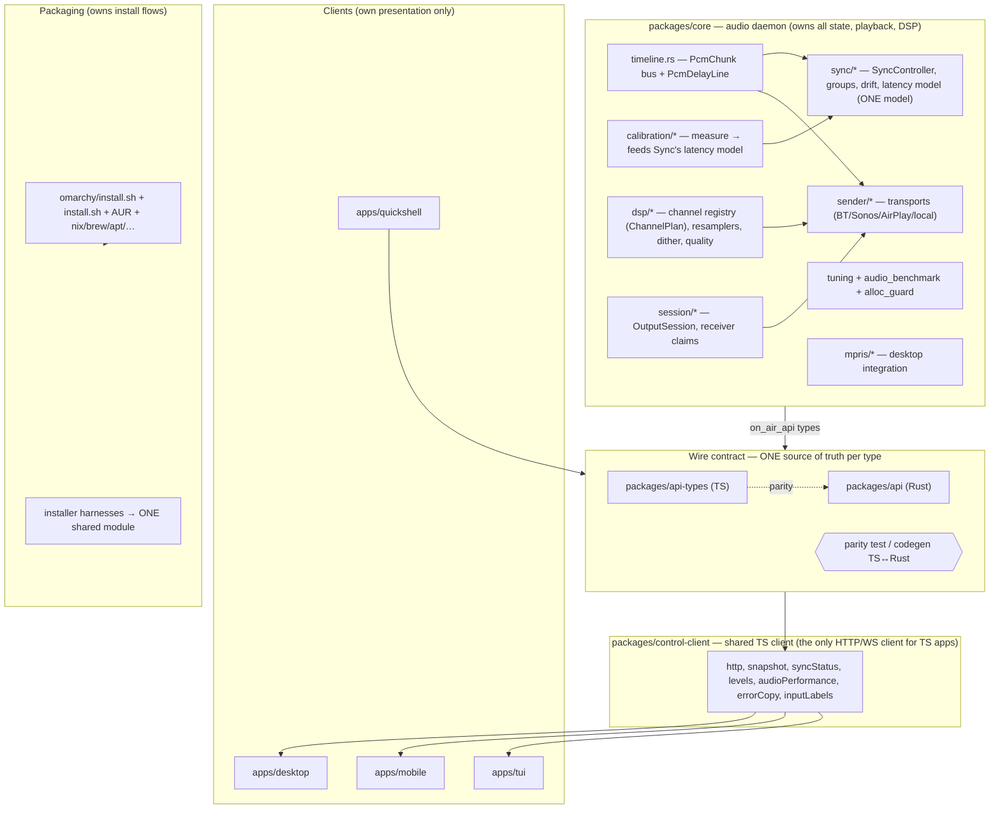

# Independent Architecture & Duplication Review — 2026-10-19

**Scope:** all open PRs in `tsonubin/on-air` (#11–#28), read-only.
**Reviewer:** independent agent (branch `docs/review-2026-10-19`, based on `origin/main` = `c2df7b5`).
**Non-goals:** no code changes to PR branches, no CI changes, no builds/tests run
(CPU is saturated; this is a reading analysis). No PR comments posted.

---

## Method

1. **Evidence base.** Every claim below is grounded in one of:
   `gh pr view <n>`, `gh pr diff <n>`, `git diff origin/main...origin/<branch>` (three-dot,
   merge-base aware), `git show origin/<branch>:<path>`, or direct file reads on the
   PR branch via `git show origin/<branch>:<path>`. Diffstat summaries come from
   `git diff --stat`. Every concrete claim below (file paths, symbols, line
   numbers, duplication counts, commit shas, diffstats) was re-verified against
   the branch heads listed in §10 (`git rev-parse origin/<branch>`; heads
   observed 2026-10-19). Line numbers cite the tree where they were checked —
   individual-PR trees for seam defects, the #26 stack tree for cross-PR
   duplication sites — because the shared files drift between branches. Where a
   statement is an inference not directly observed it is marked `[INFERENCE]`.
   The one defect called out as a **bug** (the `keys: "c"` display bug, §1) was
   verified at **both** #26 and #28 branch heads. Note: the PR branches are
   being updated in parallel; re-check the heads before acting on §5 numbers.
2. **Concept map first.** Before judging any PR, we map which shared *concepts*
   (playout timelines / cross-protocol sync, channel registries, level meters,
   DSP quality selection, installers/packaging, keymaps, client-facing API surfaces)
   each PR touches, and where each concept lives in the layering
   (core Rust crates → server/API → clients → packaging).
3. **Duplication test.** Two implementations count as duplicated when they encode the
   same invariant or protocol detail in two places, even if names differ. We look for:
   - the same state machine / clock model in core and in a client,
   - the same registry/table defined twice,
   - the same conversion/quantization math in two crates,
   - the same capability negotiation in more than one API shape,
   - copy-paste across clients (desktop / mobile / TUI / quickshell) that will drift.
4. **Layering test.** A layering violation is a dependency that points "sideways" or
   "up" relative to the target architecture (§ Target Architecture): e.g. core audio
   crates importing client/UI concepts, clients reimplementing server logic, packaging
   scripts reaching into source internals they don't own.
5. **Overlap/conflict test.** For each pair of PRs that touch the same files we record
   whether they conflict textually (same hunks), semantically (same concept, different
   shape), or merely adjacently (same file, different regions). Textual conflicts were
   computed mechanically with `git merge-tree --write-tree --name-only` across all
   branch pairs (18 branches, 153 pairs).
6. **Integration PR #23** is assessed separately: what it contains relative to the
   individual PRs it claims to integrate (#11, #16, #17, #18, #19, #21, #22, and
   now #24), whether it adds anything of its own, and whether it supersedes or
   fights those PRs.
7. **Verdicts.** Each PR gets one of: *merge as-is* / *fix first* / *fold into another* /
   *close*. Recommendations weigh architecture fit above feature completeness.

## Outline

1. Executive summary
2. Repository map (where each shared concept lives today)
3. Per-PR findings — scope, architecture fit, duplication, risk, recommendation
4. Cross-PR duplication matrix
5. Conflict / overlap map
6. What integration PR #23 actually does
7. Target architecture
8. Recommended merge order
9. Concrete deduplication plan (file/function level)
10. Appendix — PR ↔ branch ↔ verdict
11. Decisions for Shay

---

## 1. Executive summary

**This is not 18 independent PRs.** It is a dependency stack of 13 feature
slices built up as **copied (cherry-picked) commits, not shared history**, plus a
few independent slices, plus 4 continuation branches that carry the entire stack's
tree. The commit *subjects* are shared across branches but the *shas* generally
are not. Concretely:

- Every branch forks `origin/main` = `c2df7b5`; no branch is a git ancestor of
  another. Yet `feat/e2e-coverage`, `feat/acoustic-calibration` and
  `test/keymap-collision` each carry 125–127 changed files against main —
  the *same* 117 files as `integration/core-stack` plus their own ~10. Blob-hash
  spot-checks (`git show origin/<branch>:<path> | git hash-object`) show these shared
  files are **byte-identical** across the four branches (`packages/core/tests/
  transport_exclusivity.rs`, `packages/core/src/timeline.rs`, `packages/core/src/dsp/
  channel.rs`, `packages/core/src/pipeline/alloc_guard.rs`, `packages/core/src/sync/
  lifecycle.rs`, `packages/core/tests/api_sync.rs`; blob hashes equal on all
  four trees). This is **copied work, not divergent work** — the risk is
  merge-order and double-maintenance, not two competing designs. (The few
  files that *do* differ are the ones the later branch's own commits extend:
  `sync/mod.rs` and `sync/latency.rs` grow on #26 for calibration, and
  `apps/tui/src/{update,keys,model,view/overlay}.rs` differ on #26/#28 for the
  Calibrate modal and the key fix — e.g. `apps/tui/src/update.rs` is one blob
  on #23/#25 and another on #26/#28.)
- **#23 (`integration/core-stack`) is the real review surface for the core stack.**
  It is the union of `#11 → #16 → #17 → #18 → #19 → #21 → #22`, plus a merge of
  `feat/channel-modes` (#24), plus 3 reconciliation commits that exist in **no**
  individual PR: `87cee8b` ("Integration fixes for the merged stack"),
  `2e6dbde` (auth fix for a test the merge broke), `8aa3157` (fmt). Its 25
  content commits are carried at **identical shas** to the individual PRs
  (25/25 verified — each sha is an ancestor of its PR branch). But note the
  fine print, verified at the branch heads: each of those 8 PR branches also
  carries **1–2 tip commits that #23 does not have** (`style: run cargo fmt`,
  #11's `e4f1f0e` test fix, #17's `7e70967` fixture fix), so merging #23 does
  **not** make their diffs collapse to empty and will **not** auto-close them.
  The tip deltas are small and content-subsumed (§6) — close the 8 PRs
  manually with a note; don't merge their tips. Merge #23 **as a merge
  commit, not squash**.
- **#23's own PR description is stale.** It states `feat/channel-modes` "is
  deliberately left out of this branch", but the branch now merges it
  (`04474cc Merge branch 'feat/channel-modes' into integration/core-stack`).
  Fix the description before merge.
- **#25/#26/#28 are continuations of #23's tree, not independent features.**
  #25 adds e2e tests (and closes 3 mock-core gaps in product code). #26 adds the
  acoustic-calibration harness. #28 adds TUI help-scroll + key-table guard + the
  key-collision fix. **#26 and #28 are byte-identical trees** (verified:
  `git diff --stat origin/feat/acoustic-calibration origin/test/keymap-collision`
  is empty at the heads). They share the calibration + key-fix commits at
  identical shas (`a54734b`, `dc5337e`, `33f58c9`) and each carries the same
  help-scroll/guard fix under a different sha (`bfa00aa` on #26, `1d6295b` on
  #28 — near-identical patches to the same 7 TUI files that converge to the
  same content). **Merge one, close the other as a duplicate** — there is no
  unique delta to fold either way, and merging both is a clean no-op. Do not
  treat them as two features.

- **One real defect found in #28's own content — and #26's** (verified at both
  branch heads):
  `apps/tui/src/keys.rs`'s `KEYS` table advertises `keys: "c"` for **both**
  `Action::CycleChannel` (line 72) and `Action::Calibrate` (line 132), while
  `action_for` maps `'c' => CycleChannel`, `'C' => Calibrate` (lines 238–239).
  The help overlay prints `binding.keys` verbatim (`view/overlay.rs::help_overlay`), so
  users are told calibration is on `c` when it is actually on `C`. The new guard
  (`every_action_in_the_help_table_is_reachable`, `keys.rs`) checks action
  *reachability* but not that the advertised key string matches the matcher — so this
  slips through. **Fix before merge** (on whichever branch survives).

**Duplicated concepts** (the architectural drift Shay asked about). Full matrix in §4;
the headline rows:

| Concept | How many places | Verdict |
|---|---|---|
| `DspQuality` enum | 2 Rust defs (`packages/api/src/lib.rs` wire; `packages/core/src/dsp/quality.rs` core) | **Duplicate.** #21's own doc admits it. Collapsed to a re-export in the #23/#26 stack (`dsp/quality.rs` 58→33 lines). |
| Meter dB math (lin→dBFS, −60 dB floor) | 2 languages (`tui/update.rs::level_db`; `control-client/levels.ts::levelFraction`) | Same transform + floor constant spelled twice. |
| DSP quality labels/costs/order/default | 2 sets + server copy ignored (`control-client/audioPerformance.ts`; `tui/cli.rs`+`update.rs`) | Verbatim TS↔Rust duplicate; all pickers ignore the server's `profiles` list; `"balanced"` default ×3. |
| Sync trim limit (±10 s) | 3 constants (core `sync/latency.rs`, `control-client/syncStatus.ts`, `tui/update.rs`) | Same bound in three places. |
| Sync-group "move" (leave-then-add) | 3 hand-rolled client state machines | Server refuses `AlreadyInGroup`; **no atomic move endpoint**. |
| Level-meter component | 3 UIs; `desktop/LevelMeter.tsx` and `mobile/level-meter.tsx` are skeleton-twins (identical `QUIET_MS`/`SILENT`/`ChannelBar`/timeout logic, DOM vs RN renderer) | Copy-paste per framework. |
| Wire type definitions | 2 typed + 1 untyped (quickshell raw XHR) | No TS↔Rust parity check. **#18 proves silent drift is possible** (its TS half asserts stereo `LevelMeter` while the same-branch Rust core still sends mono). |
| Installer test harnesses | 2 Python harnesses, 0 shared code (+ a 3rd `test-plugin.py`) | Same mock/JSONL design, ~5% literal (boilerplate fragments), not factored. |
| Error code→message copy | 3 code→message maps + 1 desktop wrapper | Texts already diverged (`service_paused` reads three different sentences). |
| Download-URL / version / checksum | versions ~15 files (2 gates, different canonicals); URLs ≥7 sites; checksum pinned repo-time **and** install-time | Not centralized. |

**Merge conflicts** (mechanical, §5): the pairwise `git merge-tree` is clean
only between *disjoint* PRs. The core stack conflicts heavily **with itself**
(`feat/sync-groups ↔ feat/channel-modes` = 30 files, `feat/first-run-tuning ↔
feat/sync-groups` = 23, `feat/playout-timeline ↔ feat/sync-groups` = 21) because
each branch re-carries earlier slices as copies that were then independently evolved.
The continuation branches (#25/#26/#28) conflict only in their own commits' files.
The independent PRs (#12/#13/#14/#15/#20/#27) conflict with nothing except
#12×#20 (`packaging/omarchy/test.sh`) and #14×#12 (semantically: stale install text).

**Recommended path (detail in §8):** merge **#23 as a merge commit** → close
#11/#16/#17/#18/#19/#21/#22/#24 manually (content carried; tip deltas subsumed —
§6) → trim #25's test bloat and merge → merge **#26** (fixing the `keys: "c"`
bug), close #28 as its byte-identical duplicate → #13 → #27 → #15 → #20 → #12
→ #14 (after updating its install text). Then execute the dedup plan (§9) on main.

---

## 2. Repository map (where each shared concept lives today)

| Layer | Crates / dirs | Concept homes |
|---|---|---|
| Core audio daemon | `packages/core` (`api`, `cd`, `dsp`, `patchbay`, `pipeline`, `sender`, `session`, `sync`, `timeline`, `calibration`, `mpris`, `tuning`, `alloc_counting`) | timeline/PcmChunk bus, sync groups/drift/latency, channel registry/modes, meter math, dither/quantization, MPRIS, tuning/benchmark/alloc-guard, calibration |
| Wire contract | `packages/api` (Rust types), `packages/api-types` (TS types) | `DspQuality`, `ChannelMode`, `MeterLevel`, `SyncState`, `OutputSyncStatus`, `SyncGroup*`, `SetSyncTrimRequest`, error envelope. **Two sources of truth.** |
| Shared client | `packages/control-client` | `http.ts`, `snapshot.ts`, `syncStatus.ts`, `levels.ts`, `audioPerformance.ts`, `errorCopy.ts`, `inputLabels.ts` |
| Clients | `apps/desktop` (Tauri/React), `apps/mobile` (Expo/RN), `apps/tui` (Rust/ratatui), `apps/quickshell` (QML) | per-framework meter/quality/sync UIs, keymaps, quickshell raw-XHR client |
| Packaging | `packaging/omarchy/*`, `packaging/install.sh` (desktop), `packaging/aur/*/PKGBUILD`, `packaging/{debian,rpm,apt,flatpak,nix,winget}`, `Formula/`, `Casks/` | one-line installer, AUR recipes, checksums |
| Tests | `packages/core/tests/*`, `e2e/` (#25), `packaging/omarchy/test.sh` + `test-install.py`, `packaging/test-install.py` (#20) | core integration tests, e2e (Playwright), installer harnesses |
| Docs/site | `docs/`, `website/` (#14) | roadmap, history, project site |

---

## 3. Per-PR findings

Legend: **Scope** / **Architecture fit** / **Duplication** / **Risk** /
**Recommendation.** PR↔branch and stats are in the §10 appendix.

### #11 `feat/clean-audio-dither-quality`
- **Scope.** TPDF dither + round-to-nearest for float→L16; `L16_SCALE = 32768.0`
  (exact inverse); `scale_l16` rounds instead of truncating. `dsp/bridge.rs`,
  `pipeline/mod.rs`, `sender/bluetooth_pcm.rs`.
- **Fit.** Clean; dither lives in `dsp`, consumed by `pipeline`/`sender`.
- **Duplication.** Minor: rounding spelled twice (float `round()` in
  `f32_to_l16_le`; integer `±50/100` in `scale_l16`) — different domains, acceptable.
- **Risk.** Low. `pipeline/mod.rs` collides with #16's (same function, both add
  locals) — exactly #23's conflict row #1.
- **Recommendation: fold into #23.** Self-contained, correct; merged via #23's
  integration (which keeps `TpdfDither` + `L16_SCALE` in every quantization path).

### #12 `feat/one-line-install`
- **Scope.** `packaging/omarchy/install.sh` becomes a `curl|sh` one-line
  installer (release prebuilt / `--source` / `--checkout` / `--version` /
  `--prepare-only`); AUR recipes made submission-guideline-compliant (0BSD
  `LICENSE`, `.gitignore`, `on-air-LICENSE` rename, `optdepends`
  `owntone-server`/`uv`); docs lead with the curl one-liner.
- **Fit.** Good — reuses the existing `packaging/aur/on-air-bin` recipe rather than
  inventing a new format; extends `test.sh`'s consistency gate (recipe structure +
  checksum drift).
- **Duplication.** (a) The fake-release fixture is built **twice** (shell
  `test.sh` and Python `test-install.py`, same `v9.0.0` trick). (b) Install-time
  checksum pinning (`stage_release_bin` sed-pins `sha256sums_*`) overlaps
  `packaging/update-checksums.sh`'s repo-time job. (c) Install prose duplicated
  across `INSTALL.md`, `README.md`, `docs/omarchy.md`, `packaging/README.md`.
- **Risk.** `packaging/omarchy/test.sh` is also patched by #20 from the same base
  blob in adjacent hunks → ordering dependency (the pair auto-merges cleanly
  today; re-check after either lands). `website/index.html`
  (#14) carries the **pre-#12** Omarchy install block → user-facing contradiction.
- **Recommendation: fix first, then merge** (after #20 lands; re-check its
  `test.sh` change — the two branches auto-merge cleanly today, but the hunks are
  adjacent). Fold the fixture duplication and reconcile with
  `update-checksums.sh` in a follow-up.

### #13 `docs/roadmap-action-plan`
- **Scope.** `docs/design/2026-10-18-roadmap.md` (7 workstreams, ~50 tasks,
  dependency graph, 7 milestones) + a history record + a small design-doc revision.
- **Fit.** Docs-only planning; no README/INSTALL duplication.
- **Duplication.** Roadmap content echoed by #14's `website/index.html` `#roadmap`
  section and `CHANGELOG.md` — low severity.
- **Risk.** None. Its flagged points (B8 changes the "exactly one output"
  invariant; G5 notes a design doc now contradicted by MPRIS-as-goal) are honest.
- **Recommendation: merge as-is.**

### #14 `feat/project-site`
- **Scope.** `website/` static site (index + build log + CSS + theme.js),
  `CHANGELOG.md` extended, one README link, one history record. Nothing else.
- **Fit.** Plain HTML/CSS/JS, no build step, deliberately outside the workspace —
  reasonable and documented.
- **Duplication.** `website/index.html` duplicates INSTALL.md/README install
  instructions **verbatim and already stale against #12** (shows the pre-#12
  clone-based Omarchy install). Hardcodes `VERSION=0.2.0` (ungated by either
  consistency gate). Duplicates #13's roadmap.
- **Risk.** Semantic (not textual) conflict with #12: after both merge the site
  tells users to install differently from `INSTALL.md`.
- **Recommendation: fix first** (update the install section to match #12's
  one-liner once #12 lands; gate the version string). Then merge.

### #15 `feat/patchbay-drag-only`
- **Scope.** quickshell patchbay: drag-only cables (right-click a rope deletes
  immediately, whole-curve hit test), media widget + toasts, discoverability
  (Omarchy menu row), docs.
- **Fit.** Self-contained in `apps/quickshell` + `packaging/omarchy/snippets` +
  `docs/omarchy.md`. Conflicts with **nothing** in the merge-tree matrix.
- **Duplication.** (a) quickshell is a **fourth client stack**: a hand-rolled
  `CoreClient.qml` (raw XHR) speaking `/api/*` directly — no
  `@on-air/control-client`, no `@on-air/api-types`, `port 47990` re-hardcoded
  (`MediaWidget.qml apiPort`, `Widget.qml setting("port", 47990)`), patchbay ops as
  untyped QML string literals (a private `"__service"` op not in `PatchbayCommand`).
  (b) Now-playing line composed **3×**: `MediaWidget.qml line`/`detail`,
  `Widget.qml mediaLine`, `omarchy-menu.jsonc on-air.now` (sed over `on-air
  status`). (c) Its `docs/omarchy.md` Media section says "the core does not speak
  MPRIS today" while #19's `feat/mpris-bridge` implements exactly that surface in
  parallel — the same future surface defined in two places.
- **Risk.** Low for merge; the duplication is drift risk for later.
- **Recommendation: merge as-is** (only PR touching quickshell). Note the MPRIS
  doc overlap with #19 and the now-playing triple-derivation as follow-ups.

### #16 `feat/playout-timeline`
- **Scope.** `timeline.rs` (`PcmChunk { first_frame, captured_at, pcm }`,
  `PcmDelayLine`), `sync/{group,latency,drift}.rs`, `SyncController`/`SyncFeed`,
  `SteerableResampler`, `RateBridge::new_steered`, `api/sync.rs`
  (`GET /api/sync`, `PUT /api/sync/trim`), bus type → `broadcast::Sender<PcmChunk>`.
  Latency defaults (AirPlay 2000 / Bluetooth 150 / local 50 / Sonos 1000 ms) all
  documented-unmeasured.
- **Fit.** The foundation the whole stack rests on. Sound; no acoustic claims.
- **Duplication.** `RateBridge`'s `new` and `new_steered` each re-write the
  struct-literal field list ("Two constructors, one struct, two copies of the field
  list") — the direct cause of the #11×#16 non-compiling auto-merge
  (`missing field dither`). The "local 50 ms" figure is duplicated from
  `sender/bluetooth_pcm.rs`'s `--latency-msec=50` literal (and `pipeline/`'s 50) with
  only a comment tying them.
- **Risk.** Known defects at the seams (verified on #16's tree):
  `api/sync.rs:39` `req.trim_ms.abs()` — `i32::MIN.abs()` panics (debug) /
  mis-validates (release); `api/stream.rs:282` radio drift measured from
  body-pull (can't observe receiver clock); `sender/bluetooth.rs:381`
  `TrySendError::Full` silently drops delay-line frames. (On the merged stack
  the same sites sit at `api/sync.rs:58` and `bluetooth.rs:390/399`.)
- **Recommendation: fold into #23.** Its content (incl. the union resolution that
  gives `new_steered` the `dither` field) lives in #23.

### #17 `feat/stereo-meter-quality`
- **Scope.** `stereo_levels()` per-channel RMS+peak → `WsEvent::LevelMeter{left,right}`;
  `DspQuality` profiles (wire enum) + resampler quality (Farrow-128 / sinc-256);
  sync-aware Sonos recovery (`SonosSender::with_sync`, `plan_resync`).
- **Fit.** Carries **#16's commits as copies** (its log literally contains
  `feat(core): shared playback timeline…`). `sync/group.rs` and `sync/mod.rs` are
  **drifted** copies of #16's (this branch adds a ~35-line `plan_resync`,
  `sync/mod.rs:134` on #17's tree, absent from #16).
- **Duplication.** (a) Defines `on_air_api::DspQuality`; **#21 then defines a second
  `DspQuality`** in `core/dsp/quality.rs` — the one true cross-crate duplicate (its
  doc admits: "When the two trees merge, this type should collapse into a
  re-export of the shared one — nothing else changes."). (b) Meter reads pre-quantization f32 — consistent with #11, no
  duplication there.
- **Risk.** Its PR body is a **near-verbatim copy of #18's body** (identical
  through the client-surface walkthrough — describes client surfaces, not this
  PR's core work) — a description defect that confuses review.
- **Recommendation: fold into #23.** Note the `DspQuality` duplicate is resolved
  only in the #23/#26 shape of `dsp/quality.rs`.

### #18 `feat/client-audio-surfaces`
- **Scope.** Surfaces stereo meters + DSP quality + sync controls in desktop, mobile,
  TUI; `control-client` gains `levels.ts`, `audioPerformance.ts`, `syncStatus.ts`
  slices and `getAudioQuality`/`setAudioQuality`/`getSync`/`setSyncTrim`.
- **Fit.** Wire-contract split: its TS half flips `LevelMeter` to stereo
  (`api-types/src/index.ts:419` on #18's tree) and TUI decodes stereo, but the branch
  **does not touch** `packages/api/src/lib.rs` or `packages/core` (verified: the
  three-dot diff contains zero files under `packages/api/` or `packages/core/`;
  its own PR body: "types come from the sibling slices and are not included in
  this diff"). So the
  branch alone does not compile against its own `on-air-api`; it works only merged
  with #16+#17. [INFERENCE — compile behaviour, corroborated by the file list]
- **Duplication.** (a) `apps/desktop/src/ui/LevelMeter.tsx` and
  `apps/mobile/src/ui/level-meter.tsx` are **skeleton-twins**: identical `QUIET_MS`,
  `SILENT`, `ChannelBar`, timeout effect and doc comment, differing only in the
  DOM vs RN renderer layer. Event
  pacing `METER_INTERVAL_MS = 50` + throttle duplicated in `useCoreSnapshot.ts:74`
  and `useDesktopConnection.ts:226`. (b) `control-client/src/audioPerformance.ts:15-33`
  quality labels/costs duplicated word-for-word by `tui/src/cli.rs:15-29` +
  `update.rs::QUALITIES`; default `"balanced"` hardcoded ×3. (c) `syncStatus.ts`
  centralizes trim copy for TS; TUI re-implements `TRIM_LIMIT_MS`
  (`update.rs::TRIM_LIMIT_MS`, :200-201 on the stack) and the state words
  (`view/route.rs`). (d) Three
  drift/trim row formats (`DeviceList.tsx`, `output-sheet.tsx`, `view/route.rs`).
- **Risk.** Contract drift is real: the TS/Rust halves of the wire types can diverge
  with no check, and this PR is the proof (mono Rust core vs stereo TS). Also
  `main`'s `docs/design/2026-10-17-stereo-pipeline.md:36-37,52-55` explicitly rules
  out per-channel meters — directly contradicted here.
- **Recommendation: fold into #23** (its content is in the stack). The duplication
  (meter ×2, quality labels, trim limit) is a follow-up dedup target.

### #19 `feat/mpris-bridge`
- **Scope.** In-process D-Bus MPRIS bridge (`org.mpris.MediaPlayer2.on-air`),
  `mpris/{mod,model,bridge}.rs`, `cd::control` as the one dispatch path shared with
  `POST /api/cd/control`, `CoreState` change-notice watch. zbus 6, Linux-only.
- **Fit.** Good. Command path is genuinely shared (`cd::control`), not duplicated.
  Activation model (connect only while a disc/active output exists) is well-reasoned.
- **Duplication.** None against other core PRs. Its test module (328 lines,
  17 tests in `mpris/model.rs`) is mostly
  contract-mapping (legitimate — guards real MPRIS↔core behaviour).
- **Risk.** Layering smell: `bridge.rs::raise_tui()` shells out to
  `omarchy-launch-or-focus-tui on-air` / `xdg-terminal-exec -e on-air` — core knows
  the TUI binary + desktop launcher names. The desktop-integration surface (zbus) is
  compiled into the audio daemon core rather than a separate crate.
- **Recommendation: fold into #23.** Consider a configurable `raise_tui()` command
  as a follow-up.

### #20 `feat/desktop-installer-ci`
- **Scope.** Tests `packaging/install.sh` (desktop/Tauri installer) decision + failure
  paths: 28 tests, real installer run with PATH-mocked tools recording JSONL,
  `unshare -Ur -m` fakes `/etc/arch-release`, tree-delta assertions. **Also fixes a
  real bug:** `install_as_root` returned 0 unconditionally — a failed `pacman -U`
  printed "Installed on-air-desktop" and exited 0.
- **Fit.** Valuable and well-built; modelled on `packaging/omarchy/test-install.py`.
- **Duplication.** (a) `packaging/test-install.py` (667 lines) is an **independent
  implementation of the same harness design** as `packaging/omarchy/test-install.py` —
  shared `MOCK` recorder + `run_installer` skeleton + `INSTALL_TEST_LOG`/
  `INSTALL_TEST_BUILD_FAIL` env contract, ~5% literal overlap (boilerplate
  fragments), **zero shared module**.
  A third variant `packaging/omarchy/test-plugin.py` repeats the style again. (b) The
  suite is wired to run **twice per CI job** (inside `packaging/omarchy/test.sh:106`
  **and** as its own `ci.yml:114` step — and `ci.yml:112` runs `test.sh` too);
  `bash -n packaging/install.sh` also appears twice inside `test.sh` (:105 and :182).
- **Risk.** (a) `packaging/omarchy/test.sh` hunks sit adjacent to #12's — the pair
  auto-merges cleanly today (0 merge-tree conflicts), but re-check the hunk after
  either lands.
  (b) It institutionalizes an **npm fallback** (`DEFAULT_MOCKS` includes `"npm"`,
  `test_missing_pnpm_and_npm_stop_before_building` pins "pnpm or npm is required")
  — a strict reading of Shay's pnpm-only rule would contradict #20's pinned
  behaviour. (c) ~~Flagged but out of scope~~ **already fixed on the branch**: the
  PR body flags that a `pacman -U` failure after `sudo -n true` is swallowed, but
  the tip commit `047115c` fixes exactly that (`install_as_root` now carries the
  exit status) and pins it (`test_a_failing_package_install_is_reported_as_a_failure`).
  The PR body is stale; the residual risk is nil.
- **Recommendation: fix first** — dedupe the double CI run (run the suite once),
  decide the npm-fallback question explicitly (Decisions for Shay). The
  `install_as_root` bug fix is genuinely important and should not be blocked on
  the harness dedup.

### #21 `feat/first-run-tuning`
- **Scope.** `tuning.rs` (`decide`/`apply_verdict`/`spawn_first_run_watcher`, trigger =
  `recommended_dsp_quality.is_none()`, once per machine), `dsp/quality.rs` (core-local
  `DspQuality`), `audio_benchmark.rs` (+`recommended_quality`),
  `alloc_counting.rs` + `pipeline/alloc_guard.rs` (audio path allocates nothing per chunk),
  `GET /api/audio/tuning`.
- **Fit.** Reuses the existing benchmark machinery; the trigger and "never overwrite a
  user's choice" rule are sound and well-tested.
- **Duplication.** (a) `core::dsp::quality::DspQuality` **duplicates
  `on_air_api::DspQuality`** verbatim (enum + serde) — self-documented. (b) "audio
  check" / "benchmark" / "first-run tuning" are three names for one run. (c)
  "worst round trip" (scheduler timing) collides conceptually with #26's acoustic
  round trip.
- **Risk.** It rewrote the audio path to a `*_into` zero-alloc API and
  `run → BenchmarkOutcome`, which is why the #11/#16/#17 content had to be unioned
  carefully (#23 conflict rows #6–#7). It also redefines the `dsp_quality` settings
  field (`Option<DspQuality>`) that #17 set as non-`Option` — #23 adopts #21's
  design wholesale.
- **Recommendation: fold into #23.** The `DspQuality` duplicate is the key dedup
  item; the #23 stack already collapses it.

### #22 `feat/sync-groups`
- **Scope.** Named sync groups over the API (`/api/sync/groups*`), `sync/lifecycle.rs`,
  `SyncGroupView`/`SyncGroupMember` wire types, `sync_groups` in `settings.json`,
  `activate_scheduled` + receiver-claim refusal; sync groups in **every** client.
- **Fit.** The resource model (an output is in ≤1 group; `AlreadyInGroup` → 409;
  membership takes effect at next start; `start` = one epoch; refusal of two
  sessions per receiver) is coherent and documented.
- **Duplication.** (a) Its log **re-carries #16/#17/#18 commits as copies**
  (`fdfbda1` = reworked copy of `c06e728`; `8ae729b` = reworked copy of `9dcc1a1`)
  — hence `sync/mod.rs` reaches 546 lines here vs 313 in #16. (b) The **leave-then-add
  "move" dance is implemented in all three clients** because the server refuses a move
  and offers no atomic endpoint: `useSyncGroups.ts:52-68`, `sync-groups.tsx:71`
  (`pick`), `client.rs::Cmd::JoinSyncGroup{from}`. (c) Group-name 1..=64 validated
  in 3 clients + server (`sync/lifecycle.rs::NAME_MAX_CHARS`).
- **Risk.** Large surface (93 files). The client-side state machines will drift unless
  a server-side move endpoint replaces them.
- **Recommendation: fold into #23** (its content is in the stack). The move-endpoint
  dedup is the highest-leverage client cleanup (§9 D6).

### #23 `integration/core-stack`
- **Recommendation: merge as the integration of record (merge commit, not squash),
  after correcting its stale description.** See §6. Supersedes #11/#16/#17/#18/#19/
  #21/#22/#24.

### #24 `feat/channel-modes`
- **Scope.** Per-output channel mode (auto/stereo/mono) + structural channel-count
  registry: `dsp/channel.rs` (`SinkConstruction` registry of every construction site;
  `ChannelPlan` with private fields, sole constructor `SinkConstruction::plan`);
  `RateBridge`/resamplers take only `&ChannelPlan`; `PUT /api/outputs/channel-mode`;
  rejection copy for stereo-on-mono.
- **Fit.** Structurally strong — "no call site can spell a channel count at all";
  two exhaustive matches force classification of new sender sites. The inherited sketch
  was finished and bug-fixed (the sketch's own test unwrapped a documented
  rejection).
- **Duplication.** The "bus is always stereo" invariant is spelled 3×
  (`dsp/mod.rs::PIPELINE_CHANNELS`, `timeline.rs::FRAME_BYTES`,
  `pipeline/mod.rs::stereo_levels`) with different parameterizations — complementary,
  not competing, but worth one spelling. Naming: `ChannelMode::Auto` vs
  `SinkConstruction::auto()` are different "auto"s.
- **Risk.** Conflicts with #22 at 30 files if merged independently. But its commit
  `ce96be9` is carried in #23 at the **same sha** (real merge).
- **Recommendation: fold into #23** (already merged there; #23's description just
  needs updating to say so).

### #25 `feat/e2e-coverage`
- **Scope.** e2e coverage for the new API surface (`e2e/desktop/audio-surface.spec.ts`
  +618, `e2e/shared/{scenarios,mockCore}.ts`, `e2e/mobile/companion.e2e.ts`, …).
  Built on #23's base. Also **closes the 3 mock-core gaps its PR body documents**
  in product code: (1) mock `LevelMeter` — `pipeline/input.rs::MockFeed` feeds the
  real processing thread silence so genuine frames flow, with
  `sender/bluetooth_pcm.rs::RecordingPcmSink` as the recording sink; (2) mock
  settings persistence (`CoreState::new_mock`, `ON_AIR_CONFIG_DIR`-gated);
  (3) mock radio URL (`GET /api/mock/radio`). Adds `TuningStatus`/`FirstRunTuning`
  TS wire types.
- **Fit.** Drives the surface through the real `control-client` — the one thing core
  tests cannot. But it reaches that goal by **extending shipped product code with
  test-only surface** (`GET /api/mock/radio`, mock persistence, `MockFeed`,
  `RecordingPcmSink`). [INFERENCE: intended, but it widens the shipped binary's
  surface; worth an explicit "mock-only" doc/gate.]
- **Duplication — the test-bloat concern (Shay's test-audit rule).** The e2e suite
  re-pins ~10 invariants **already pinned in `packages/core/tests/*`**: trim-per-output
  + clamp (`api_sync.rs::sync_trim_round_trips_through_the_status`), trim validation
  (`api_sync.rs::sync_trim_validates_range_and_transport`), one-epoch group start
  (`api_sync.rs` + `sync_timeline.rs`), `AlreadyInGroup` refusal
  (`api_sync.rs::an_output_cannot_be_in_two_groups_at_once`), leave-stops-one-member
  (`api_sync.rs::leaving_a_group_stops_that_member_cleanly…`), group lifecycle validation
  (`api_sync.rs::sync_group_requests_validate_and_refuse_conflicts`), tune-once
  (`first_run_tuning.rs::a_machine_that_has_been_checked_is_never_tuned_again`),
  mono-WAV (`stream_endpoint.rs::a_mono_channel_mode_serves_a_genuine_mono_wav…`),
  meter shape (`ws_events.rs`), quality get/put (`audio_performance.rs`). It also pins
  **exact user-facing prose** (`audio-surface.spec.ts:437` and `:488` assert the full
  `"Mono Speaker plays mono only; stereo would drop the right channel. Choose
  Auto or Mono."`), **byte-identical WAV bytes** (`:524`), and hard numbers that
  bake in the 1000 ms Sonos default (`{trim_ms: 250, effective_latency_ms: 1250}`).
- **Risk.** Exact-prose + byte-identity + hardcoded-default assertions are
  implementation-coupled; a legitimate copy tweak or a default change turns them red.
  Per Shay's test rule, trim to contract-level assertions (envelope shape, status
  codes, `calibrated:false` until measured, `0 ≤ rms ≤ peak ≤ 1`).
- **Recommendation: fix first** — trim the duplicate invariants to the genuinely
  e2e-only value (client-library conformance, real WebSocket subscription, restart
  persistence, desktop error banner), then merge on top of #23. The mock-core gaps
  are fine but should be documented as mock-only.

### #26 `feat/acoustic-calibration`
- **Scope.** B10 acoustic latency calibration harness: chirp probe
  (`calibration/probe.rs`, published on the existing `PcmChunk` bus — "there is no
  second audio path"), matched-filter detector with confidence
  (`calibration/{detect,mod}.rs`), mic capture (`calibration/record.rs` via the product's
  own `pipeline::capture`), orchestration (`calibration/run.rs`),
  `POST /api/sync/calibrate`, `sync::latency.rs` grows to
  `effective_latency_us(transport, measured_us, trim_ms)`, `SyncController::set_calibration`,
  TUI `Calibrate` modal + `on-air calibrate` CLI. Honest about no hardware being
  available.
- **Fit.** Good — measurement feeds the **one** latency model
  (`sync/latency.rs::base = measured_us ?? default; + trim; clamp ≥ 0`). Three entry
  points (defaults / trim / measurement), not three models.
- **Duplication.** (a) Shares the calibration + key-fix commits with #28 at identical
  shas. (b) Carries the help-scroll + key-guard fix as `bfa00aa`
  ("fix(tui): fix the calibrate tests and make the help overlay scroll")
  vs #28's `1d6295b` ("scroll the help overlay and guard the key table") —
  near-identical patches to the same 7 TUI files (`keys`, `model`, `update`,
  `update/tests`, `view/mod`, `view/overlay`, `view/tests`) under different shas.
  Crucially, the two branches' heads converge to **byte-identical trees**
  (verified: `git diff origin/feat/acoustic-calibration origin/test/keymap-collision`
  is empty). (c)
  Contains the `keys: "c"` display bug (§1) — Calibrate row advertises `c`, matcher
  uses `C`.
- **Risk.** The `i32::abs()` trim-validation edge case is inherited from the stack.
  Merging both #26 and #28 is a clean no-op (0 merge-tree conflicts, same tree) —
  the risk is double bookkeeping (two open PRs for one content set), not code.
- **Recommendation: merge #26** (after fixing the `keys: "c"` display bug), and
  **close #28 as its byte-identical duplicate** — there is no unique delta to fold.
  Calibration and keymap are one coherent TUI story here.

### #27 `chore/pnpm-only`
- **Scope.** `apps/mobile/scripts/publish-testflight.sh:267` `npx --yes eas-cli` →
  `pnpm dlx eas-cli`. Correct: it's the only literal `npx` in the repo.
- **Fit.** Trivial and correct. Its own PR body flags the two remaining `npm install`
  bootstraps (`packaging/install.sh:24`, `packaging/flatpak/build.sh:8` — installing
  pnpm itself, chicken-and-egg) and recommends `corepack`, explicitly deferred
  because those scripts ship to users and are under review in #12/#20. **Sensible call.**
- **Duplication.** None. **Risk.** None.
- **Recommendation: merge as-is.** The corepack migration is a reasonable follow-up
  once #12/#20 land.

### #28 `test/keymap-collision`
- **Scope.** TUI help overlay now scrolls (mouse wheel; `model.help_scroll`,
  `view/overlay.rs help_overlay(..., scroll)`); `every_action_in_the_help_table_is_reachable`
  guard; `KEYS.len()` hardcoded 26→27; key collision `c` resolved (`c`→`CycleChannel`,
  `C`→`Calibrate`).
- **Fit.** The collision it fixes was **introduced by the stack itself** (#24's `c`
  for channel-mode met #26's `c` for calibration; one arm became
  `unreachable_pattern`). Neither PR alone has the bug. So this is integration
  fallout, appropriately found and fixed — but it lives on a separate branch that
  duplicates #26's.
- **Duplication.** Carries the **same** calibration + key-fix commits as #26
  (`a54734b`, `dc5337e`, `33f58c9`) plus the help-scroll/guard fix
  (`1d6295b`) under a different sha from #26's `bfa00aa`. At the branch heads
  the two trees are **byte-identical** (verified) — #28 is #26's content with a
  different commit layout (`2d640bb` fmt on top here; fmt under the fix there).
  Merging both is a clean no-op (0 conflicting files).
- **Risk — the verified bug.** The `KEYS` table still advertises `keys: "c"` for
  **both** `CycleChannel` (line 72) and `Calibrate` (line 132) while `action_for` maps
  `'C' => Calibrate` (line 239). The help overlay prints `binding.keys` verbatim
  (`view/overlay.rs::help_overlay`) → **the user is shown `c` for calibration but must press
  `C`**. The guard checks reachability, not key-string correctness, so it passes.
  **Real, user-facing defect in #28's own content (and #26's) — fix before merge.**
- **Recommendation: close as a duplicate of #26** (or merge this one and close #26 —
  the content is the same; pick one PR to avoid double bookkeeping), fixing the
  `keys: "C"` correction on whichever survives.

---

## 4. Cross-PR duplication matrix

Rows = shared concept. "✓" = a distinct implementation exists there. Locations in §3 / §9.

| Concept | core (Rust) | api (Rust wire) | api-types (TS) | control-client (TS) | desktop | mobile | tui (Rust) | quickshell | packaging | Dup? |
|---|---|---|---|---|---|---|---|---|---|---|
| `DspQuality` enum | ✓ `dsp/quality.rs` | ✓ `api/lib.rs` | ✓ | re-export | — | — | re-export | — | — | **YES — 2 defs** |
| Quality labels/costs/order/default | — | `profiles` (ignored) | — | ✓ `audioPerformance.ts` | uses | uses | ✓ `cli.rs`+`update.rs` | — | — | **YES — 2 sets + server** |
| Meter dB math (lin→dBFS, −60 floor) | — | linear `MeterLevel` | — | ✓ `levels.ts` | — | — | ✓ `update.rs::level_db` | — | — | **YES — 2 languages** |
| Meter component (RMS+peak bar) | ✓ `stereo_levels` | — | — | ✓ `levelFraction` | ✓ `LevelMeter.tsx` | ✓ `level-meter.tsx` (skeleton-twin) | ✓ `view/mixer.rs` | — | — | **YES — 3 UIs, 2 skeleton-twins** |
| Meter pacing/throttle | — | — | — | ✓ | ✓ `useCoreSnapshot` | ✓ `useDesktopConnection` | ✓ `main.rs` | — | — | **YES — 3 copies** |
| Sync trim limit ±10 s | ✓ `sync/latency.rs` | ✓ | — | ✓ `syncStatus.ts` | — | — | ✓ `update.rs` | — | — | **YES — 3 constants** |
| Sync-group "move" (leave+add) | `AlreadyInGroup` refusal | — | — | — | ✓ `useSyncGroups` | ✓ `sync-groups.tsx` | ✓ `client.rs` | — | — | **YES — 3 state machines** |
| Group-name 1..=64 | ✓ `lifecycle.rs` | ✓ | — | — | ✓ | ✓ | ✓ | — | — | **YES — 4× (3 clients + server)** |
| Sync state/trim row format | ✓ | ✓ | — | ✓ labels | ✓ fmt A | ✓ fmt B | ✓ fmt C | — | — | **YES — 3 formats** |
| Wire types (full) | — | ✓ `api/lib.rs` | ✓ `api-types` | re-export | — | — | ✓ mirror | ✓ untyped XHR | — | **YES — 2 typed + 1 untyped, no parity check** |
| HTTP client | — | — | — | ✓ `http.ts` | wraps | wraps | ✓ `client.rs` | ✓ `CoreClient.qml` | — | **YES — 3** |
| Error code→copy | — | ✓ envelope | — | ✓ `errorCopy.ts` (map) | ✓ `lib/errorCopy.ts` (wrapper + overrides) | ✓ `errors.ts` (map) | ✓ `error_copy.rs` (map) | — | — | **YES — 3 maps + 1 wrapper, texts diverged** |
| Input labels/dedupe | — | — | — | ✓ `inputLabels.ts` | — | — | ✓ `labels.rs` (port) | — | — | **YES — 2** |
| Keymap declarations | — | — | — | — | — | — | ✓ `keys.rs` (`KEYS` table + `action_for` matcher) + `update.rs` modal hints | ✓ `PatchbayView.qml` | ✓ `bindings.conf\|lua` | **YES — 3 surfaces; TUI splits one binding set over table + matcher + hints** |
| Default port 47990 | — | ✓ `DEFAULT_PORT` | ✓ `DEFAULT_PORT` | — | ✓ `tauri.conf.json` CSP | — | ✓ `DEFAULT_BASE` + `overlay.rs::DEFAULT_PORT` | ✓ `apiPort` (3 QML files) | — | **YES — ≥6 sites** |
| Now-playing summary | — | — | — | — | — | — | — | ✓ `MediaWidget` + `Widget` | ✓ `omarchy-menu.jsonc` | **YES — 3 (within #15)** |
| Patchbay ops | ✓ `api/patchbay.rs` | — | ✓ `PatchbayCommand` | — | — | — | — | ✓ QML strings (`"__service"` private) | — | **YES — untyped mirror** |
| Quantization rounding | ✓ `bridge.rs` + `bluetooth_pcm.rs` | — | — | — | — | — | — | — | — | minor (2 domains) |
| Latency defaults/consts | ✓ `sync/latency.rs` 50 ms | — | — | — | — | — | — | — | ✓ `bluetooth_pcm.rs` `--latency-msec=50`; `pulse.rs` 30 | **YES — tied only by comment** |
| Installer test harness | — | — | — | — | — | — | — | — | ✓ `omarchy/test-install.py` + `test-install.py` + `test-plugin.py` | **YES — 2 designs, 0 shared code** |
| Checksum pinning | — | — | — | — | — | — | — | — | ✓ `update-checksums.sh` + #12 `stage_release_bin` | **YES — 2** |
| Install instructions | — | — | — | — | — | — | — | — | ✓ README + INSTALL + omarchy.md + packaging/README + website | **YES — 5, website stale** |
| Download URLs / versions | — | — | — | — | — | — | — | — | ✓ ~15 version files, ≥7 URL sites | **YES — ungated `nix`/`website`** |
| Timeline / sync model | ✓ `timeline.rs`+`sync/*` (1 impl) | ✓ | — | — | — | — | — | — | — | **No — single model (good).** |
| Drift/epoch/baseline math | ✓ `sync/*`+`api/stream.rs` (1 impl) | ✓ | — | labels only | labels only | labels only | labels only | — | — | **No — clients only round/label (good layering).** |
| Channel registry | ✓ `dsp/channel.rs` (1) | ✓ | — | — | — | — | — | — | — | **No — but "stereo bus" invariant spelled 3×.** |

---

## 5. Conflict / overlap map

Mechanical (`git merge-tree --write-tree --name-only`) across all 18 branches
(153 pairs). Only conflicting pairs shown; counts = conflicted files.

| Pair | Files | Nature |
|---|---|---|
| `feat/sync-groups` ↔ `feat/channel-modes` | 30 | same core files rewritten by both (#22 re-carries #16/#17; #24 adds registry) |
| `feat/first-run-tuning` ↔ `feat/sync-groups` | 23 | `*_into` audio-path rewrite × group registry |
| `feat/playout-timeline` ↔ `feat/sync-groups` | 21 | #22 contains a *reworked copy* of #16 → `add/add` on `sync/group.rs`, `sync/mod.rs`, `api/sync.rs`, `sync_timeline.rs` |
| `feat/stereo-meter-quality` ↔ `feat/first-run-tuning` | 19 | `DspQuality` + audio path |
| `feat/stereo-meter-quality` ↔ `feat/sync-groups` | 17 | copied #16/#17 content diverged |
| `feat/client-audio-surfaces` ↔ `feat/channel-modes` | 16 | client surfaces for both |
| `feat/channel-modes` ↔ `feat/stereo-meter-quality` | 15 | registry × `DspQuality`/audio path |
| `feat/playout-timeline` ↔ `feat/first-run-tuning` | 14 | audio-path rewrite |
| `feat/first-run-tuning` ↔ `feat/channel-modes` | 13 | audio path × channel registry |
| `feat/playout-timeline` ↔ `feat/channel-modes` | 11 | `stream.rs`/`bridge.rs`/`bluetooth*.rs` |
| `feat/clean-audio-dither-quality` ↔ `feat/first-run-tuning` | 3 | `bridge.rs`, `pipeline/mod.rs`, `bluetooth_pcm.rs` |
| `feat/clean-audio-dither-quality` ↔ `feat/stereo-meter-quality` | 2 | `bridge.rs`, `pipeline/mod.rs` |
| `feat/clean-audio-dither-quality` ↔ `feat/sync-groups` | 2 | `bridge.rs`, `pipeline/mod.rs` |
| `feat/clean-audio-dither-quality` ↔ `feat/channel-modes` | 2 | `bridge.rs`, `pipeline/mod.rs` |
| `feat/clean-audio-dither-quality` ↔ `feat/playout-timeline` | 1 | `pipeline/mod.rs` |
| `feat/playout-timeline` ↔ `feat/mpris-bridge` | 1 | `state.rs` |
| `feat/playout-timeline` ↔ `feat/stereo-meter-quality` | 1 | `bluetooth_pcm.rs` |
| `feat/stereo-meter-quality` ↔ `feat/mpris-bridge` | 1 | `state.rs` |
| `feat/stereo-meter-quality` ↔ `feat/client-audio-surfaces` | 4 | TUI meter render |
| `feat/client-audio-surfaces` ↔ `feat/first-run-tuning` | 4 | TUI client/update |
| `feat/client-audio-surfaces` ↔ `feat/sync-groups` | 2 | TUI client/view |
| `feat/mpris-bridge` ↔ `feat/sync-groups` | 1 | `state.rs` |
| #25/#26/#28 ↔ core-stack branches | 1–6 | only their own commits' files (TUI keys/update/view + core sync/api) |
| #26 ↔ #28 | **0** | byte-identical trees at the heads — a clean no-op merge |
| `integration/core-stack` ↔ individual core PRs | 1–6 | the individuals' uncarried tip commits (fmt / test fixes) vs #23's own fmt + `87cee8b` |
| #12 ↔ #20 | 0 (auto-merge) | adjacent hunks in `packaging/omarchy/test.sh` merge cleanly today; re-check after either lands |
| #13/#14/#15/#27 ↔ anyone | 0 | disjoint |

**Reading.** The core stack conflicts *with itself* because every branch re-carries
earlier slices as copies that were then independently evolved. This is why the
integration PR exists and why merge order matters: merging the individuals in
sequence would each require re-deriving #23's 14 documented conflict resolutions. The
continuation branches (#25/#26/#28) are internally consistent (byte-identical shared
files) — they conflict only where their own commits overlap, and #26/#28 are the
same tree. Conversely, after #23 lands, merging any individual PR's branch conflicts
in 1–6 files (its tip fmt/test-fix commits) — one more reason to close them rather
than merge them.

---

## 6. What integration PR #23 actually does

`git log origin/main..origin/integration/core-stack` = 36 commits:

- **25 shared/copied content commits** — carried at **identical shas** to the
  individual PRs: `5931bd6` (#11 dither), `c06e728` (#16 timeline),
  `9dcc1a1` (#17 meter/quality), `2892d939`/`76cc6b8`/`952eadb`/`5bb90fc`/
  `20fc1d8`/`10b0c3b`/`fdb21cf`/`356de8c`/`37edd32`/`2f57e4c` (#18 client
  surfaces), `8ee0133` (#19 MPRIS), `4547eed`/`7623427` (#21 tuning),
  `fdfbda1`/`0deebe8`/`8ae729b`/`62ef131`/`538b39d`/`486fac0`/`a0dd151`/`0ef4deb`
  (#22 sync groups), `ce96be9` (#24 channel modes — **same sha as
  `feat/channel-modes`'s commit**).
- **7 merge commits** — the reconciliation lives in their trees + messages
  (`6650430`, `a89f11c`, `331f112`, `3166133`, `54c8f12`, `c78a109`, `f127da2`).
  Their documented union choices (14 rows in #23's PR body) are real and required —
  e.g. `RateBridge::new/new_steered` carry **both** `quality` and `TpdfDither`;
  `f32_to_l16_le_into` quantizes with `L16_SCALE`+dither (never the truncating
  `i16::MAX`); two `DspQuality`s collapsed to `on_air_api::DspQuality` re-exports;
  #21's first-run-tuning adopted wholesale over #17's setters; #22's `AlreadyInGroup`
  refusal wins.
- **4 integration-only commits** (in no individual PR):
  - **`87cee8b` "Integration fixes for the merged stack"** — the key one.
    2 files, +15/−7: (1) `settings.rs` `SettingsCommand::Flush(Box<SavedSettings>, …)`
    — needed only once `sync_trims`+`dsp_quality`+`channel_modes`+`sync_groups`
    all coexist (`clippy::large_enum_variant` fires only on the union);
    (2) `tests/pipeline_processing.rs::stereo_frames_keep_their_sides_through_the_eq`
    — silent-channel bound `== 0.0` → `≤ 1.0/32768.0` (one LSB = the dither's
    documented noise floor). The only assertion adapted anywhere in the stack.
  - **`04474cc`** "Merge branch 'feat/channel-modes' into integration/core-stack" —
    the merge of #24 (union resolutions across ~30 files). **This contradicts #23's PR
    description**, which says channel-modes is "deliberately left out".
  - **`2e6dbde`** "test: authenticate the channel-mode request in the radio stream
    test" — `tests/stream_endpoint.rs` +11 (PIN + Bearer for
    `PUT /api/outputs/channel-mode`); the stack's `Paired` extractor made the test
    return 401 vs expected 204. Fixes a test the merge broke.
  - **`8aa3157`** "style: run cargo fmt" (34 files, +502/−236) — duplicated by
    #25's `6323b33` **as the identical patch** (`git patch-id --stable` matches),
    i.e. the same reflow applied twice.

**Is #23 a mere union?** **No.** Beyond combining the seven + #24, it adds the two
reconciliation commits above and carries the conflict resolutions in its merge trees. If
the individuals merge first, **#23 is not empty** — its `87cee8b` + `2e6dbde` +
fmt + the documented union forms must still land. Conversely, if #23 merges first
(merge commit), every content commit of #11/#16/#17/#18/#19/#21/#22/#24 becomes an
ancestor at an identical sha — that part of the plan is sound (25/25 verified).

**What merging #23 does *not* do (correcting an earlier draft of this review):**
it does not make the 8 PRs' diffs empty and it will not auto-close them. Each of
those branches carries **1–2 tip commits that are not in #23** (verified with
`git log origin/integration/core-stack..origin/<branch>` and `git cherry`):

| PR branch | Uncarried tip commits | Residual content vs #23's tree |
|---|---|---|
| #11 `feat/clean-audio-dither-quality` | `7ba1ebd` fmt, `e4f1f0e` test fix | `e4f1f0e` bounds the silent channel at `1.0/32768.0` — semantically subsumed by `87cee8b`'s stronger rewrite of the same assertion |
| #16 `feat/playout-timeline` | `eb2e7da` fmt | reflow only |
| #17 `feat/stereo-meter-quality` | `48b6c3b` fmt, `7e70967` fixture fix | fixture updates present in #23 except one `queue.current!` → `?.` hunk, which #25's lint pass (`5b548b6`) drops anyway |
| #18 `feat/client-audio-surfaces` | `d30a7ee` fmt | reflow only |
| #19 `feat/mpris-bridge` | `22f68a0` fmt | byte-equal to #23's tree on all 4 files |
| #21 `feat/first-run-tuning` | `80052b1` fmt | reflow only |
| #22 `feat/sync-groups` | `aacbf1d` fmt | reflow only |
| #24 `feat/channel-modes` | `c2404b4` fmt | reflow only |

So: **merge #23 as a merge commit (squashing would destroy the identical-sha
ancestry and leave every PR with a spurious full-stack diff)**, then **close the
8 PRs manually** with a note that their content is carried and their tip deltas
are fmt-only or subsumed. Expect their diffs to stay non-empty — that is
history, not outstanding work. If squash-merge is chosen anyway, the same manual
closes apply but nothing becomes an ancestor and the diffs against the new main
look alarming; don't.

---

## 7. Target architecture

**Layering rules the current tree should converge on:**

1. **Wire types single-sourced.** Domain enums (`DspQuality`, `ChannelMode`,
   `MeterLevel`, `SyncState`) should be defined once and mirrored by a parity test or
   codegen. Today `packages/api` and `packages/api-types` are two hand-kept sources
   and quickshell is a third untyped one — and #18 proved drift is silent. Prefer
   generating one from the other, or a CI parity check.
2. **Domain enums host in `core`, not in `api`.** Today `core` re-exports
   `on_air_api::{DspQuality, ChannelMode}` (`dsp/mod.rs`, `dsp/channel.rs`) — the
   wire crate hosts domain types. Invert it (define in `core`/a domain crate, `api`
   re-exports) or at least stop growing the pattern.
3. **One latency model.** Already true: `sync/latency.rs` is the single arithmetic
   (`base = measured ?? default`, `+ trim`, `clamp ≥ 0`). Keep the three entry points
   (defaults / trim / measurement), not three models. Tie the `local 50 ms` default to
   `sender/bluetooth_pcm.rs`'s `--latency-msec=50` by a shared constant, not a comment.
4. **One channel registry.** Already true (#24): `SinkConstruction`/`ChannelPlan` is
   the only place a channel count is decided. Fold the "stereo bus" invariant into it
   (`PIPELINE_CHANNELS`, `FRAME_BYTES`, `stereo_levels` should derive from one
   spelling).
5. **One meter math + one meter component per language.** Keep
   `control-client/src/levels.ts` as the TS source; either generate the TUI's
   `level_db`/`METER_FLOOR_DB` from the same spec or parity-test the constants.
   Desktop/mobile should share the meter component (they are already skeleton-twins —
   make it one file with two renderers).
6. **Sync-group membership is server state; clients render, never orchestrate.** Replace
   the three leave-then-add shims with an atomic `PUT /api/sync/groups/{id}/members`
   (move) endpoint. Drop the 3× group-name client validation in favour of the server
   envelope (keep it only as a UX hint).
7. **Packaging owns its inputs, one harness skeleton.** Extract the shared
   `MOCK`/`run_installer`/JSONL skeleton into one Python module used by
   `omarchy/test-install.py`, `packaging/test-install.py`, `test-plugin.py`. Run each
   suite **once** in CI. Centralize version/URL construction or gate the stragglers
   (`packaging/nix/on-air-core.nix`, `website/`).
8. **Keymaps: one declaration per surface.** Make `action_for` and `KEYS` derive from
   one table (or add a guard that the `keys:` string matches the matcher). Quickshell's
   inline `Keys.onPressed` and `bindings.conf|lua` are separate surfaces and can stay
   separate — but the TUI's `KEYS` table + `action_for` matcher + `update.rs` modal
   hints should become one declaration.

---

## 8. Recommended merge order

The stack is internally consistent and #23 is its reviewed, reconciled carrier.
Merging the individuals in sequence would require re-deriving 14 documented conflict
resolutions by hand. So:

**Phase 1 — land the core stack via the integration PR.**
1. **#23 `integration/core-stack`** — **merge commit, not squash.**
   - Before merging: fix its PR description (channel-modes is now included); fold
     in the outstanding CI/lint fixes; and fix the two D14 correctness seams the
     stack introduces (§9): `api/sync.rs:52` `req.trim_ms.abs()` (`i32::MIN`
     panics in debug and bypasses the ±10 s check in release) and
     `sender/bluetooth.rs:390/399`, where `TrySendError::Full` drops individual
     delay-line frames and leaves audible timeline holes. Neither is on `main`
     today, so merging #23 without them ships them.
   - This makes the content commits of #11, #16, #17, #18, #19, #21, #22, #24
     ancestors at identical shas. Then **close those 8 PRs manually** — their
     diffs will not empty out and GitHub will not auto-close them (each carries
     1–2 uncarried tip commits, all fmt-only or subsumed; §6). Do not merge
     their branches.

**Phase 2 — the continuation branches, top-down, deduplicating as we go.**
2. **#25 `feat/e2e-coverage`** — fix first: trim the duplicated invariants +
   exact-prose pins to contract-level assertions; document the mock-only product
   surface. Then merge on top of #23.
3. **#26 `feat/acoustic-calibration`** — fix first: correct the `keys: "c"` display
   bug (Calibrate should show `C`). Then **merge #26 and close #28 as its
   byte-identical duplicate** (verified: the two branch trees are equal — no fold
   needed, nothing unique on either side).

**Phase 3 — the independent slices (any order among themselves; respect the two noted dependencies).**
4. **#13** `docs/roadmap-action-plan` — as-is.
5. **#27** `chore/pnpm-only` — as-is.
6. **#15** `feat/patchbay-drag-only` — as-is.
7. **#20** `feat/desktop-installer-ci` — fix first: run the suite once in CI;
   decide the npm-fallback question. Then merge (its `install_as_root` bug fix is
   valuable).
8. **#12** `feat/one-line-install` — rebase over #20's `test.sh` change (adjacent
   hunks), then merge.
9. **#14** `feat/project-site` — fix first: update the install section to match
   #12's one-liner (and gate/recompute `VERSION`), then merge.

**Phase 4 — dedup follow-up on `main`** (§9). Nothing here should block the
merges; it is the architecture-drift paydown. The exception is D14's `trim_ms`
and Bluetooth frame-drop items, which gate #23 in Phase 1.

**Rationale for top-down (integration first):** #23 already contains the resolved
union of every core slice; #25/#26/#28 were built on its tree and their shared files
are byte-identical to it. Landing them in that order means each merge only introduces
its own commits' hunks. Landing the individuals first would mean each of the 8 core
PRs re-merges the same 21–30 conflicting files and re-derives #23's resolutions —
high risk of silent inconsistency (the `DspQuality`-duplicate and the
crosstalk-assertion cases show how subtle the required resolutions are).

---

## 9. Concrete deduplication plan (file/function level)

Ordered by leverage. Each is independently actionable.

**D1 — Land #23 as a merge commit; close the 8 superseded PRs.**
`origin/integration/core-stack` carries `#11/#16/#17/#18/#19/#21/#22/#24`'s content
at identical shas + `87cee8b`/`2e6dbde`/`8aa3157`. Merging it (not squash) makes
those content commits ancestors. The 8 PRs still carry 1–2 uncarried tip commits
(fmt / two small test fixes) so their diffs will **not** empty out and they will
**not** auto-close — close them manually with a note (tip deltas subsumed, §6).
If squashed instead, nothing becomes an ancestor and the closed PRs show full-stack
spurious diffs; don't.

**D2 — Collapse `DspQuality` to one definition.**
`packages/core/src/dsp/quality.rs` (#21, 58 lines) duplicates
`packages/api/src/lib.rs::DspQuality` (#17). The #23/#26 stack already reduces
`dsp/quality.rs` to docs + `pub use on_air_api::DspQuality` (verified: 33 lines,
one `enum DspQuality` in the tree, in `packages/api`). Keep that shape. Same
pattern for `ChannelMode` (`dsp/channel.rs` re-exports it) — keep, but don't add
a third.

**D3 — One keymap source; fix the `keys: "c"` display bug.**
- `#26 bfa00aa` ("fix(tui): fix the calibrate tests and make the help overlay
  scroll") and `#28 1d6295b` ("fix(tui): scroll the help overlay and guard the key
  table") are the same fix under different shas, and the two branches converge to
  byte-identical trees. Merge one (#26), close the other — nothing to fold.
- **Bug:** `apps/tui/src/keys.rs` `KEYS` shows `keys: "c"` for both `CycleChannel`
  (line 72) and `Calibrate` (line 132); `action_for` maps `'C' => Calibrate`
  (line 239). Change the Calibrate row to `keys: "C"`. Extend
  `every_action_in_the_help_table_is_reachable` to also assert the advertised `keys:`
  string matches the matcher (or derive `KEYS` from one table). Affected:
  `keys.rs:72-74`, `:132-134`, `:238-239`, `view/overlay.rs::help_overlay`.

**D4 — Wire-type parity between `packages/api` and `packages/api-types`.**
#18's TS half asserts `LevelMeter{left,right}` while its own branch's Rust core sends
mono — proof the two can drift silently. Add a CI parity check (or codegen
`api-types` from `api`). Candidates to pin: `LevelMeter`, `DspQuality`,
`ChannelMode`, `SyncState`, `OutputSyncStatus`, `SyncGroup*`, `SetSyncTrimRequest`,
`TuningStatus`, error envelope. Quickshell's untyped XHR is a third surface — at
minimum document its routes against `api-types`.

**D5 — One meter component per language + one scale spec.**
- TS: `apps/desktop/src/ui/LevelMeter.tsx` and `apps/mobile/src/ui/level-meter.tsx` are
  skeleton-twins (same `QUIET_MS`, `SILENT`, `ChannelBar`, timeout; DOM vs RN
  renderer delta). Extract one shared component with a DOM renderer and an RN renderer.
- Scale math: `packages/control-client/src/levels.ts::levelFraction` +
  `METER_FLOOR_DB = -60` vs `apps/tui/src/update.rs::level_db` +
  `model.rs::METER_FLOOR_DB = -60.0`.
  Share the constant (parity test) or generate.
- Pacing: `useCoreSnapshot.ts:74` (`METER_INTERVAL_MS = 50`) /
  `useDesktopConnection.ts:226` / `tui/main.rs::FRAME` (50 ms) each re-declare the
  50 ms beat.

**D6 — Sync-group move endpoint (kills 3 client state machines).**
`core/src/api/sync.rs:192` refuses `AlreadyInGroup` (`sync/lifecycle.rs:56,117`);
there is no move. Hence
`desktop/hooks/useSyncGroups.ts:52-68` (`setMembership` = leave→add),
`mobile/src/sheets/sync-groups.tsx:71` (`pick`), `tui/src/client.rs::Cmd::JoinSyncGroup{from}`
each hand-roll it. Add
`PUT /api/sync/groups/{id}/members` (or `POST .../members/move`) that does leave+add
atomically server-side; replace the three shims. Keep the server's `AlreadyInGroup`
refusal for the non-move add. Also fold the 3× group-name client validation
(`useSyncGroups.createGroup`, `sync-groups.tsx:57` (`canCreate`),
`tui/update.rs:203-204 GROUP_NAME_MAX`) to UX hints only (server already validates
in `sync/lifecycle.rs`).

**D7 — DSP quality labels from the wire, not per-client copies.**
`control-client/src/audioPerformance.ts:15-33` (`DSP_QUALITY_OPTIONS/LABELS/COSTS/
DESCRIPTION`) is duplicated verbatim by `tui/src/cli.rs:15-29` (`quality_label`,
`quality_cost`) + `tui/update.rs:210` (`QUALITIES`). The server already sends
`AudioQualityResponse.profiles`/`recommended` — have all three pickers iterate the wire
list (and move the cost strings to the wire or one shared map). Default `"balanced"` is
hardcoded in `AudioPerformance.tsx:84`, `audio-format.tsx:116`, `tui/update.rs:1515`.

**D8 — One trim-limit constant + one sync-row format spec.**
`sync/latency.rs::TRIM_LIMIT_MS`, `control-client/src/syncStatus.ts::SYNC_TRIM_LIMIT_MS`,
`tui/update.rs::TRIM_LIMIT_MS` (all `10_000`, verified) — one constant. The drift/trim
row has 3 formats
(`DeviceList.tsx`, `output-sheet.tsx`, `view/route.rs`); keep native
forms but share the label set (`syncStatus.ts::SYNC_STATE_LABELS` is already central for
TS; TUI `view/route.rs` should reuse it or be parity-checked).

**D9 — One installer-harness module; run each suite once.**
`packaging/omarchy/test-install.py`, `packaging/test-install.py` (#20, 667 lines),
`packaging/omarchy/test-plugin.py` share the `MOCK` JSONL recorder + `run_installer`
skeleton + `INSTALL_TEST_*` env contract (~5% literal — boilerplate fragments —
100% design). Extract
`packaging/testing.py` with the shared skeleton. Drop #20's duplicate CI invocation
(the suite runs in `omarchy/test.sh:106` *and* at `ci.yml:114`, while `ci.yml:112`
already runs `test.sh`; `bash -n packaging/install.sh` also appears at
`test.sh:105` and `:182`). Also fold #12's duplicated
fake-release fixture (shell `test.sh` vs Python `test-install.py`, same `v9.0.0`
trick — verified in both files).

**D10 — Version/URL/checksum single-sourcing.**
Versions live in ~15 files with **two gates using different canonicals**
(`packaging/omarchy/test.sh` → `packages/core/Cargo.toml`; `release.yml` →
`apps/desktop/src-tauri/tauri.conf.json`). `packaging/nix/on-air-core.nix:13` and
`website/index.html` (`VERSION=0.2.0`) are in **no** gate. URLs are built in ≥7 places
(`packaging/aur/*/PKGBUILD`, `packaging/apt/install.sh`, `Casks/on-air.rb`,
`packaging/flatpak/*.yml`, `packaging/update-checksums.sh`,
`packaging/omarchy/install.sh`). Checksum pinning exists twice (repo-time
`update-checksums.sh`, install-time #12 `stage_release_bin`). Pick one canonical
(recommend `tauri.conf.json` or `Cargo.toml`, and gate the rest), and one checksum flow.

**D11 — Install instructions: one source, website generated/kept in sync.**
`README.md`, `INSTALL.md`, `docs/omarchy.md`, `packaging/README.md`, and
`website/index.html` all carry install text; #14's copy is the pre-#12 clone-based
flow. After #12 lands, update the website (and consider generating the block from
`INSTALL.md` so it can't drift).

**D12 — Error copy + input labels: parity tests, not more copies.**
`control-client/errorCopy.ts`, `tui/error_copy.rs`, `mobile/src/errors.ts` are three
full code→message maps; `desktop/lib/errorCopy.ts` is a wrapper with its own
overrides. The texts already diverged (`service_paused` reads "The audio service is
paused…" / "The monitor is off…" / "The desktop service is paused…"). There
is a good precedent (`errorCopy.test.ts` "every documented code has copy") — extend it
to a cross-map parity test. Same for `control-client/inputLabels.ts` vs `tui/labels.rs`
(a declared port).

**D13 — Name one timing vocabulary.** `latency_us`/`latency_ms`/`trim_ms`/
`delay_frames`/`capture_buffer_ms`/`latency_msec` and "worst round trip" (scheduler,
#21) vs acoustic "round trip" (#26) are five knobs and two meanings. Document the
units in one glossary (`docs/glossary.md` already exists) and rename the colliding
"round trip" to "scheduler wake latency". Also unify the trust vocabulary:
`calibrated: bool` vs `CalibrationConfidence::{High,Medium,Low}`.

**D14 — Fix the known correctness seams at layer boundaries** (cited on #16's tree;
on the merged stack the same sites sit at `api/sync.rs:58` and
`sender/bluetooth.rs:390/399`):
- `packages/core/src/api/sync.rs:39` — `req.trim_ms.abs()` panics on `i32::MIN`
  (debug) / mis-validates (release). Use `checked_abs()` or compare against the range
  directly.
- `packages/core/src/api/stream.rs:282` — radio drift is measured from HTTP body-pull,
  which cannot observe the receiver's clock; the number is unreliable for
  AirPlay/Sonos. Either drop it for unmeasured transports or document it as a lower
  bound.
- `packages/core/src/sender/bluetooth.rs:381` — `TrySendError::Full` drops delay-line
  frames silently → a timeline hole. Backpressure or drop the whole chunk with a
  report, never individual frames.

---

## 10. Appendix — PR ↔ branch ↔ verdict

| PR | Branch | +/− | Files | Verdict |
|---|---|---|---|---|
| 11 | `feat/clean-audio-dither-quality` | +172/−15 | 4 | fold into #23 |
| 12 | `feat/one-line-install` | +535/−157 | 19 | fix first (order after #20; re-check `test.sh` hunks) |
| 13 | `docs/roadmap-action-plan` | +473/−0 | 3 | merge as-is |
| 14 | `feat/project-site` | +1808/−0 | 7 | fix first (install text stale vs #12) |
| 15 | `feat/patchbay-drag-only` | +609/−119 | 19 | merge as-is |
| 16 | `feat/playout-timeline` | +2884/−133 | 33 | fold into #23 |
| 17 | `feat/stereo-meter-quality` | +4097/−198 | 47 | fold into #23 |
| 18 | `feat/client-audio-surfaces` | +2217/−127 | 49 | fold into #23 |
| 19 | `feat/mpris-bridge` | +2362/−44 | 11 | fold into #23 |
| 20 | `feat/desktop-installer-ci` | +684/−3 | 4 | fix first (npm-fallback call; dedupe double CI run) |
| 21 | `feat/first-run-tuning` | +2275/−232 | 33 | fold into #23 |
| 22 | `feat/sync-groups` | +10466/−331 | 93 | fold into #23 |
| 23 | `integration/core-stack` | +16769/−621 | 117 | **merge (merge commit, not squash)** |
| 24 | `feat/channel-modes` | +2024/−186 | 48 | fold into #23 |
| 25 | `feat/e2e-coverage` | +17729/−641 | 125 | fix first (trim test bloat) |
| 26 | `feat/acoustic-calibration` | +20942/−676 | 127 | fix first (`keys:"c"` bug) then merge; close #28 |
| 27 | `chore/pnpm-only` | +1/−1 | 1 | merge as-is |
| 28 | `test/keymap-collision` | +20942/−676 | 127 | duplicate of #26 (byte-identical tree) — close |

Stats are `gh pr diff` totals (three-dot). Heads verified 2026-10-19:
`integration/core-stack`@`8aa3157`, `feat/e2e-coverage`@`5b548b6`,
`feat/acoustic-calibration`@`bfa00aa`, `test/keymap-collision`@`2d640bb`,
`feat/clean-audio-dither-quality`@`e4f1f0e`, `feat/playout-timeline`@`eb2e7da`,
`feat/stereo-meter-quality`@`7e70967`, `feat/client-audio-surfaces`@`d30a7ee`,
`feat/mpris-bridge`@`22f68a0`, `feat/first-run-tuning`@`80052b1`,
`feat/sync-groups`@`aacbf1d`, `feat/channel-modes`@`c2404b4`,
`feat/one-line-install`@`2f8712f`, `feat/desktop-installer-ci`@`047115c`,
`feat/patchbay-drag-only`@`0b9aa8a`, `feat/project-site`@`b99135b`,
`docs/roadmap-action-plan`@`03f63b8`, `chore/pnpm-only`@`f1f938a`.

---

## 11. Decisions for Shay

Calls only the owner can make; everything else in this review is actionable
without him.

1. **#23 merge shape.** Merge commit (recommended — preserves the identical-sha
   ancestry so the 8 core PRs can be closed as carried) vs squash (simpler click,
   but destroys the ancestry and every closed PR shows a full-stack spurious diff).
2. **Which of #26/#28 survives.** The trees are byte-identical; the content is one
   feature set. Recommended: merge #26 (its title matches the content), close #28.
   Either is defensible; what must not happen is both staying open as if they were
   two features.
3. **npm fallback in the desktop installer (#20).** The harness pins
   "pnpm or npm is required" and `DEFAULT_MOCKS` includes `npm`. Your stated rule
   is pnpm-or-bun only — but shipping installers run on user machines where pnpm
   may not exist. Keep the npm fallback (as #20 pins), or enforce pnpm-only and
   change the pinned behaviour? Same question for the two `npm install … pnpm`
   bootstraps (#27 recommends `corepack`, deliberately deferred).
4. **Mock-only surface in shipped binaries (#25).** `GET /api/mock/radio`, mock
   settings persistence and `RecordingPcmSink` live in product code to make the
   surface e2e-drivable. Acceptable as-is (documented mock-only), or gate behind a
   compile-time flag / separate binary?
5. **How hard to trim #25's tests.** The suite re-pins ~10 core invariants and
   pins exact prose (line 437/488), WAV byte-identity (line 524) and a
   default-dependent number (`{trim_ms: 250, effective_latency_ms: 1250}`).
   Trim to contract-level assertions (my recommendation per your test rule), or
   keep the copy/byte pins as deliberate regression guards?
6. **Install-text and version canonicals (D10/D11).** Which file is the canonical
   version (`tauri.conf.json` vs `packages/core/Cargo.toml` — the two existing
   gates disagree on canonical), and should `website/` install text be generated
   from `INSTALL.md` or maintained by hand? Also: gate `packaging/nix` and
   `website/` versions or leave them out?
7. **API and layering investments.** (a) Atomic sync-group move endpoint (D6) —
   an API addition; (b) relocating domain enums from `packages/api` into `core`
   (§7 rule 2); (c) TS↔Rust wire parity: codegen vs parity test (D4). Each is real
   work; the review can't set the priority.
8. **MPRIS bridge placement (#19).** Keep `zbus`/desktop-launcher knowledge inside
   `packages/core` (as now, with `raise_tui()` hardcoding launcher names) or split
   a desktop-integration crate? Cosmetic now, structural later.
