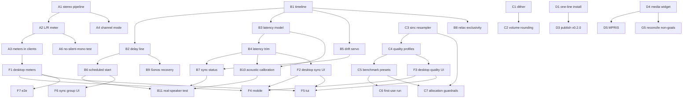

# on-air roadmap — action plan

**Date:** 2026-10-18
**Status:** living document. Every item is a task with dependencies, an owner slice and an acceptance test.

This is the plan behind the six things we set out to do: true stereo, mixed-protocol
synchronization, cleaner audio, a drag-only patchbay, client updates, and a project
website. It is written against the tree as it stands after PR #10 (stereo pipeline).

Conventions used below:

- **Status** is one of `done`, `in review`, `ready`, `blocked`, `research`.
- A task is `ready` when every task named in its **Depends on** column is `done` or `in review`.
- "Acceptance" is the check that proves the task finished. If it cannot be run on
  development hardware, the task says so and names what a human must do instead.

---

## 1. Where we are

| Area | State |
| --- | --- |
| Stereo in the core pipeline | **Done** (PR #10). Interleaved L16 stereo end to end; mono destinations get `(L+R)/2`, wider destinations get silence on the extra channels. |
| Stereo in clients | **Not done.** The level meter is a single combined RMS/peak and every client drops the `LevelMeter` event entirely. |
| Cross-protocol sync | **Not started.** No timestamps on the audio bus, no shared clock, no latency model, no drift correction. Each transport free-runs. |
| Quantization quality | **In review** (PR #11). Was a truncating `as i16` cast; now round-to-nearest with TPDF dither. |
| Resampler quality | Cubic Farrow (`PolynomialDegree::Cubic`), fixed ratio chosen at construction. rubato 5.0.1 has a better and *steerable* option we are not using. |
| Benchmark | Exists (`audio_benchmark.rs` → `POST /api/audio/benchmark`) and recommends a capture buffer. It does not yet choose DSP/encoder quality. |
| Patchbay interaction | Both drag-to-connect and click-to-connect exist. The click path must go. |
| One-line install | **In review** (PR #12). |
| MPRIS / media widget / toasts | **Absent.** No MPRIS code anywhere in the tree. |
| Website | **Absent.** |
| Exclusive-output invariant | Still "exactly one output at a time" (`docs/glossary.md`). Roadmap item 2 changes this on purpose. |

---

## 2. Workstreams and tasks

### WS-A — Stereo everywhere

The core already carries stereo. What is missing is that nobody can *see* it, and
nobody can *control* it.

| ID | Task | Depends on | Status | Acceptance |
| --- | --- | --- | --- | --- |
| A1 | Stereo pipeline through capture, EQ, resampler and radio WAV | — | done | PR #10 merged; `dsp::bridge` tests cover L/R separation and the mono downmix. |
| A2 | Split the level meter into left and right | A1 | ready | `WsEvent::LevelMeter` carries `rms`/`peak` **per channel**. Meter responds to a signal present on one side only. |
| A3 | Surface L/R meters in desktop, mobile, TUI and the Quickshell panel | A2 | blocked | Each client renders two bars; a mono test tone shows energy on one bar only. |
| A4 | Per-output channel mode (stereo / mono / auto) instead of an unconditional `map_stereo` | A1 | ready | Selecting mono on a stereo destination yields a true downmix; selecting stereo on a mono device is rejected with an explanation rather than silently losing a channel. |
| A5 | Stereo-pair labelling consistent across clients | A1 | ready | Sonos `member_count ≥ 2` and AirPlay `collapse_pairs` already produce `kind: "pair"`; all four clients show it the same way. Desktop already does. |
| A6 | Regression test: no path may silently collapse stereo to mono | A2, A4 | ready | A test walks every sender construction and asserts the channel count it requests. Fails today if any sender asks for 1 channel on a 2-channel destination. |

**Risk.** A2 changes a wire type. `packages/api`, `packages/api-types` and
`packages/control-client` must move together or every client breaks.

---

### WS-B — Mixed-protocol synchronization

The hard one. The goal is that an AirPlay speaker, a Sonos speaker and a Bluetooth
speaker play the same instant of audio together.

**The architectural lever:** each receiver already gets its *own* stream URL (a fresh
nonce per activation, `session::new_stream_nonce`). That per-receiver endpoint is
already a per-transport delay line. The sync work hangs off it rather than inventing
a parallel delivery path.

| ID | Task | Depends on | Status | Acceptance |
| --- | --- | --- | --- | --- |
| B1 | Timeline on the audio bus: monotonically increasing frame index + capture timestamp per chunk | — | in review | Chunks are ordered and contiguous across a full capture; consumers that ignore the metadata still work. No added per-chunk allocation. |
| B2 | Per-output delay line in the per-receiver stream path | B1 | in review | A requested `delay_samples` of N delays the delivered PCM by exactly N frames, measured by frame index. |
| B3 | Per-transport latency model with documented defaults | B1 | in review | Defaults are written down (AirPlay ≈ 2000 ms, Bluetooth ≈ 150 ms, Pulse `--latency-msec` 50, Sonos *unmeasured*). The code never presents an estimate as a measurement. |
| B4 | User-facing latency trim per output, in milliseconds | B3 | in review | Trim is settable over the API and survives restart. Trim does not imply the value is calibrated. |
| B5 | Drift servo: variable-ratio resampling steered by measured consumption | B1 | in review | Under an artificial clock mismatch the correction moves the ratio the right way and converges. Uses rubato `Async::new_sinc` + `Adjustable::set_resample_ratio`. |
| B6 | Scheduled start epoch (pre-roll, then all members begin together) | B1, B2 | ready | Two outputs in one sync group begin at the same wall-clock instant rather than fire-now. |
| B7 | Sync status API: trim ms, drift ppm, state `syncing`/`locked`/`free-running` | B3, B4, B5 | ready | Status is readable per output and changes sensibly as drift is introduced. |
| B8 | Relax the exclusive-output invariant deliberately | B1, B2, B5 | in review | The new invariant is stated in `docs/glossary.md`, and `tests/sender_exclusivity.rs` / `tests/transport_exclusivity.rs` are **updated to pin the new rule**, not deleted and not weakened to pass. |
| B9 | Stop the Sonos recovery task restarting playback at arbitrary times | B2 | ready | Recovery preserves the timeline position, or re-enters the sync group explicitly and reports `syncing`. |
| B10 | Acoustic calibration harness (mic loopback) | B3, B4 | research | Measures real per-transport latency. **This is the only way to get honest numbers** — `docs/design/2026-08-26-on-air-design.md` is explicit that timing must be verified acoustically and never trusted from reported API latency. Until this exists, every latency figure is a documented default, not a measurement. |
| B11 | Mixed-protocol end-to-end verification on real speakers | B6, B7, B10 | blocked | Human must run three different transport types at once and listen. Cannot be automated here. |

**Honest limit.** Millisecond alignment is achievable from B1–B7. *Nanosecond*
alignment is not achievable across three independent receiver clocks with two of
them pulling an untimestamped live HTTP stream — no amount of code on our side
changes what the receiver does with its own buffer. B10 is where we find out what
the floor actually is, and B11 is where we confirm it by ear. The plan delivers
ms-level and then measures upward; it does not promise ns.

**Risk.** B8 changes a product invariant that three test files exist to defend.
It must be a conscious, documented decision.

---

### WS-C — Cleaner audio

| ID | Task | Depends on | Status | Acceptance |
| --- | --- | --- | --- | --- |
| C1 | Round-to-nearest with TPDF dither at L16 conversion; symmetric 32768 full scale | — | in review | PR #11. `quantization_error_is_unbiased` is proven to fail on the old truncating converter (−0.5 LSB) and pass on the new one (+0.004 LSB). |
| C2 | Round the `scale_l16` volume multiply | C1 | in review | Part of PR #11. |
| C3 | Upgrade the fixed-ratio resampler from cubic Farrow to windowed sinc | — | ready | Interpolation quality improves without exceeding a stated CPU budget. Shares machinery with B5. |
| C4 | DSP quality profiles (`economy` / `balanced` / `high`) | C3 | ready | Profile selects the resampler and its `sinc_len`; documented per-profile cost. |
| C5 | First-run audio check presets both capture buffer **and** DSP quality | C4 | ready | The existing `POST /api/audio/benchmark` returns a quality recommendation alongside the capture-buffer one, and it is persisted in `SavedSettings`. |
| C6 | Run the check automatically on first use | C5 | ready | A fresh install gets a preset without the user finding the button. A repeat run is cheap and non-destructive. |
| C7 | CPU budget guardrails: the audio path allocates nothing per chunk | C3, C5 | ready | A test or bench asserts steady-state allocation behaviour on the processing thread. |

**Constraint.** on-air has to run on very old hardware. C3–C5 must report their cost
and C7 is what keeps the "cleaner" work from making the product unusable on the
machines that need it most.

---

### WS-D — Omarchy and desktop integration

| ID | Task | Depends on | Status | Acceptance |
| --- | --- | --- | --- | --- |
| D1 | One-line installer (`curl … \| sh` from the repo) installing prebuilt release binaries | — | in review | PR #12. Keeps main's incremental `target/omarchy` builds, non-tmpfs build dir and sudo-auth preservation. Not runnable here until a release ≥ v0.2.0 ships the TUI binaries. |
| D2 | AUR recipes follow the submission guidelines | — | in review | PR #12. |
| D3 | Publish a v0.2.0 release so the pinned checksums stop being placeholders | D1 | ready | `packaging/update-checksums.sh` is actually run and the cask/formula/AUR/winget pins are filled. Today only v0.1.0 is published. |
| D4 | Media controller widget (Omarchy) reflecting CD transport and active output | — | in review | Widget shows what is playing. |
| D5 | D-Bus MPRIS interface | D4 | ready | External players/controls can see and drive on-air. Requires a documented interface contract first — do not stub it. |
| D6 | Toasts: output connected/disconnected/failed, audio paused/resumed, new pairing PIN | — | in review | Non-spammy; rapid changes coalesce. |
| D7 | Rework the confusing panel discoverability and empty state | — | in review | A first-time user is told to drag a cable. |
| D8 | `packaging/install.sh` (Tauri desktop) gets real CI coverage | D3 | ready | Today only `bash -n` runs on it. |

---

### WS-E — Patchbay: cables only

The panel belongs to on-air and bridges input to output. Connecting is a gesture,
not a menu.

| ID | Task | Depends on | Status | Acceptance |
| --- | --- | --- | --- | --- |
| E1 | Remove click-to-connect entirely (the "Connect to" submenu and its keyboard entry) | — | in review | No click path creates a connection. Only a socket-to-socket drag does. |
| E2 | Right-click a cable deletes it immediately | — | in review | One click, no submenu, no confirmation. |
| E3 | Hit-test the whole drawn cable curve, not just the gutter | E2 | in review | Comfortably clickable (~8–10 px) anywhere along the visible rope. |
| E4 | Keep body-drag `combine`, disclosure, footer volume/mute | — | in review | No regression in the gestures we are keeping. |
| E5 | Empty state explains how to connect | — | in review | Panel voice is unchanged. |

**Acceptance for the whole stream (human, required).** No Omarchy/Wayland session
exists on the build host, so the drag gesture and the rope hit-testing must be
clicked through by hand.

---

### WS-F — Clients

| ID | Task | Depends on | Status | Acceptance |
| --- | --- | --- | --- | --- |
| F1 | Desktop: L/R meters | A2, A3 | blocked | Two bars in `MixerFooter`. |
| F2 | Desktop: per-output latency trim + sync state | B4, B7 | blocked | Trim input and a sync indicator per output. |
| F3 | Desktop: DSP quality profile selector | C4, C5 | blocked | Shows the recommended profile and lets it be overridden. |
| F4 | Mobile: same three surfaces, using `control-client` | F1–F3 | blocked | Shares state code with desktop rather than re-implementing it. |
| F5 | TUI: same three surfaces | F1–F3 | blocked | `?` help and the key tables in `docs/omarchy.md` are updated. |
| F6 | Sync group creation UI (which outputs play together) | B6, B7 | ready | Groups can be created and their sync state seen. |
| F7 | e2e coverage for the new API surface | F1–F6 | blocked | Playwright and `node:test` suites in `e2e/` run against the mock core with no audio hardware. |

---

### WS-G — Website and history

| ID | Task | Depends on | Status | Acceptance |
| --- | --- | --- | --- | --- |
| G1 | Static site in `website/` (features, how it works, install) | — | in review | Builds with no network at runtime, no external CDN/fonts, dark and light themes, responsive, accessible. |
| G2 | Build log derived from real git history | G1 | in review | Factual and dated; nothing invented. |
| G3 | `CHANGELOG.md` Unreleased section for work in flight | G1 | in review | Matches the file's existing voice. |
| G4 | This action plan | — | done | The document you are reading. |
| G5 | Reconcile `docs/design/2026-10-13-omarchy-first-tui.md` non-goals | D4, D5, D6 | done | Revision note added 2026-10-18 calling in the MPRIS/notifications deferral; the unchanged non-goals are listed as standing. |

---

## 3. Dependency graph

---

## 4. Suggested sequence

Each milestone is independently shippable and leaves the product working.

**M1 — honest audio (now)**
`C1` `C2` `A1` `G4`. Dither and correct quantization land first because they are
cheap, safe and immediately audible on quiet material. PR #11.

**M2 — install and discoverability**
`D1` `D2` `D4` `D6` `D7` `E1`–`E5` `G1`–`G3`. The patchbay cutover and the one-line
installer are the highest visible wins per unit of risk. PR #12 plus the panel work.

**M3 — you can see the stereo you already have**
`A2` `A3` `A4` `A5` `A6` `F1` `F4` `F5`. Low risk, and it turns an invisible
improvement into something the user can confirm with their eyes.

**M4 — sync foundation**
`B1` `B2` `B3` `B4` `B8` `B9`. Timeline, delay line and the trim API, with the
exclusivity invariant changed deliberately and its tests updated to pin the new rule.

**M5 — sync, actually**
`B5` `B6` `B7` `F2` `F6` `F7`. Drift servo, scheduled start, sync status, and the
client surfaces. `C3` shares machinery with `B5` and lands alongside it.

**M6 — measured sync**
`B10` `B11`. Acoustic calibration and real multi-speaker listening. This is where
we replace documented defaults with measurements, and where we find the real floor.

**M7 — tuned audio**
`C3`–`C7`, `F3`, `D3`, `D5`, `D8`, `G5`.

---

## 5. What is deliberately not promised

- **Nanosecond sync across heterogeneous receivers.** Two of the three transports
  pull an untimestamped live HTTP stream and buffer it internally on their own
  clock. We control what we hand them and when; we do not control when they emit
  it. We will measure the floor and report it rather than claim it away.
- **Calibrated latency without hardware.** Every latency figure before `B10` is a
  documented default. The repo's own design record forbids trusting reported API
  latency, and this plan obeys that.
- **Automatic verification of the cable gestures.** QML has no headless runner
  here. `apps/quickshell/tests` covers what it can; the drag and hit-test need a
  human on a real Omarchy session.
